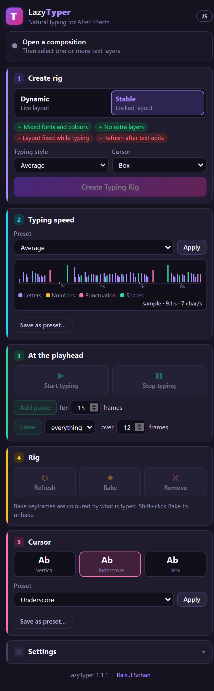

# 1. Installing, and opening the panel

LazyTyper is a panel for After Effects 2021 or newer, on Windows 10 or 11 and macOS. It is free and
signed: no extension manager, no Adobe setting to change.

## Install

1. Download `LazyTyper-v1.3.zip` from the
   [releases page](https://github.com/raisulsohan/LazyTyper/releases) and unzip it anywhere (the
   Desktop is fine).
2. Close After Effects. A running After Effects holds on to an older panel's files.
3. Run the installer from the unzipped folder:
   - Windows: double-click **Install LazyTyper.bat**.
   - macOS: double-click **Install LazyTyper (macOS).command** (if macOS refuses, right-click it
     and choose **Open**).
4. The window first reminds you to close After Effects: press a key. Wait for **Installed**, then
   press a key to close the window.
5. Start After Effects and choose **Window › Extensions › LazyTyper**. The panel opens as in the
   picture above. Dock it wherever you like; it remembers its place.

The installer copies the panel to:

| | Folder |
|---|---|
| Windows | `%APPDATA%\Adobe\CEP\extensions\com.sohan.LazyTyper` |
| macOS | `~/Library/Application Support/Adobe/CEP/extensions/com.sohan.LazyTyper` |

## Updating

Run the new version's installer the same way. Your saved presets and settings stay: they live in a
folder of their own, `%APPDATA%\LazyTyper` on Windows and `~/Library/Application Support/LazyTyper`
on macOS (`presets.json` and `settings.json`).

## Uninstalling

Close After Effects and run **Uninstall LazyTyper.bat** (Windows) or
**Uninstall LazyTyper (macOS).command**. After removing the panel it asks *Delete your presets and
settings as well?*: answer **N** (the default on macOS) to keep them for a later install, **Y** to
delete that folder too. Rigs in your projects keep working without the panel (chapter 3).

## If something is wrong

| What you see | What to do |
|---|---|
| The panel opens blank | Run **Fix a blank panel.bat** (Windows) from the download and restart After Effects. It turns on Adobe's *PlayerDebugMode* for your user account, which lets Adobe apps load a panel whose signature check did not finish on that computer. |
| LazyTyper is not in Window › Extensions | Restart After Effects: it only looks for panels when it starts. |
| The installer says another copy is installed for all users | Delete that folder (it needs administrator rights) so the two copies do not clash. |
| *There is no LazyTyper .zxp file next to this one* | Unzip the whole download first and run the installer from inside that folder. |

*Read me first.txt* in the download says the same in short. Building LazyTyper from its source is in
[Building from source](../development.md).

## Related

- [2. The panel at a glance](02-panel-at-a-glance.md)
- [3. How a rig works](03-how-a-rig-works.md)
