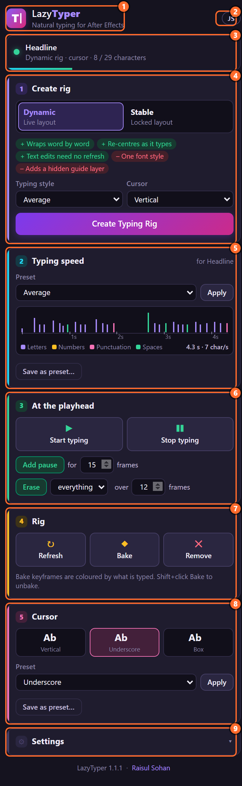
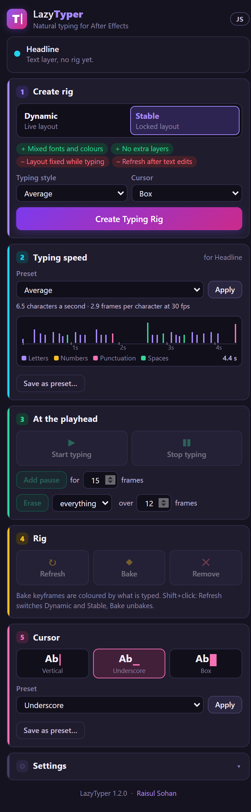
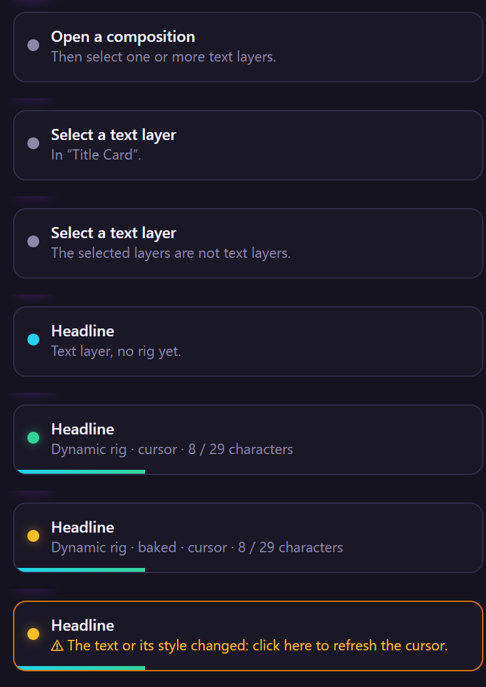
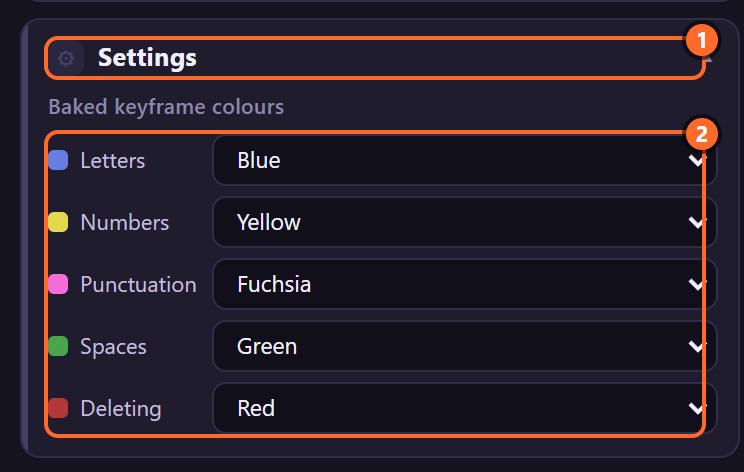

# 2. The panel at a glance

The panel is one column of cards, top to bottom in the order you use them: make a rig, set its
speed, key what happens at the playhead, look after the rig, shape its cursor.

1. **The header**: LazyTyper's name and the **engine pill** (below).
2. **The status line**: what is selected, and what state its rig is in (below).
3. **1 · Create rig**: rig type, typing style and cursor, and *Create Typing Rig*
   ([chapter 4](04-create-rig.md)).
4. **2 · Typing speed**: presets, the rhythm strip, saving your own (chapter 5).
5. **3 · At the playhead**: *Start typing*, *Stop typing*, *Add pause*, *Erase*
   (chapters [6](06-start-stop.md), [7](07-pauses.md) and [8](08-erase.md)).
6. **4 · Rig**: *Refresh* (Shift+click: switch Dynamic and Stable), *Bake* / *Unbake*, *Remove* (chapters [9](09-refresh.md) to [11](11-remove.md)).
7. **5 · Cursor**: cursor presets, *Apply*, *Add cursor*, saving your own ([chapter 12](12-cursor-presets.md)).
8. **Settings**: the colours baked keyframes get ([chapter 10](10-bake.md)).
9. Under the cards: the version, and a link to raisulsohan.com.

## What is dimmed, and why

A card that cannot do anything with the current selection is dimmed. With a text layer that has no
rig yet, only *Create rig* and the presets are live:

| Card or button | Live when |
|---|---|
| 1 · Create rig | one or more text layers are selected |
| Typing speed › Apply | a rigged text layer is selected |
| 3 · At the playhead, 4 · Rig | a rigged text layer is selected |
| 5 · Cursor › Add cursor | shown only when the selected rig has no cursor |

Selecting a rig's **cursor** or **guide** layer counts as selecting its text layer, so you can work
from whichever layer is under your hand.

## The status line

It names the selected layer (with *+N more* when several are selected) and says what it is. The bar
under it fills as the text is typed at the time indicator.

1. **Open a composition**: no composition is active.
2. **Select a text layer**, *In "Title Card".*: a composition is open, nothing is selected.
3. *The selected layers are not text layers.*
4. **Headline**, *Text layer, no rig yet.* (cyan dot)
5. **Headline**, *Dynamic rig · cursor · 8 / 29 characters* (green dot): a rig, its type, whether
   it has a cursor, and the characters showing at the time indicator out of all of them.
6. *… · baked · …*: the rig has been baked ([chapter 10](10-bake.md)).
7. **Amber**: *⚠ The text or its style changed: click here to refresh the cursor.* Click the line
   itself, or **Refresh**, to measure again ([chapter 9](09-refresh.md)).

The panel asks After Effects what is selected only while the pointer is over the panel (about once a
second), when the panel gets focus, and right after each of its actions. It never asks in the
background, which keeps After Effects free for other scripts. If the status line looks old, move the
pointer over the panel.

## The engine pill

It shows the project's expression engine (File › Project Settings › Expressions). Rigs work in both;
the JavaScript engine is several times faster on long texts. Hover over **Legacy JS** for the same
advice.

## Toasts

Every action answers in a toast at the bottom of the panel: green when it worked, amber when it
worked but skipped something or found a problem, red when it could not.

Green and amber toasts stay about 4 seconds, red ones 7. Every message and what to do about it is
in [chapter 29](29-troubleshooting.md).

## Settings

Click **Settings** at the bottom to open it. It holds the label colour each kind of baked keyframe
gets ([chapter 10](10-bake.md)):

Settings, the choices in the cards (rig type, presets) and your presets are kept between sessions in
`%APPDATA%\LazyTyper` (Windows) or `~/Library/Application Support/LazyTyper` (macOS).

## Undo

Every action of the panel is one step in Edit › Undo, named after it: *LazyTyper: Create Typing Rig*,
*LazyTyper: Erase Here* and so on. The layers you had selected stay selected.

## Related

- [3. How a rig works](03-how-a-rig-works.md): what the status line's words mean.
- [4. Creating a rig](04-create-rig.md)
- [29. When something goes wrong](29-troubleshooting.md): every message.
