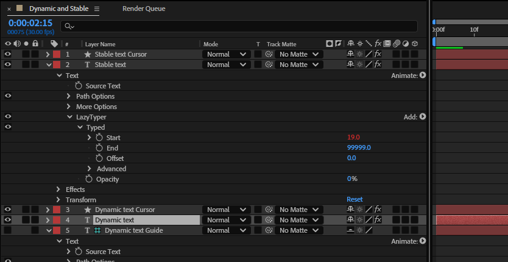
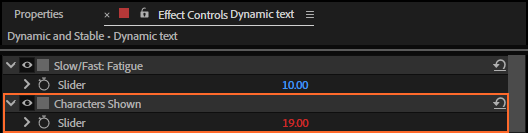

# 3. How a rig works

A **rig** is what *Create Typing Rig* adds to a text layer: a set of expression controls, an
expression that runs the typing engine, and usually a cursor layer. There are two kinds,
**Dynamic** and **Stable**. They type the same way; they differ in how the text is laid out while it
types.

*Rendered by After Effects. Left, Dynamic: each line is centred as it grows, and a word that does not
fit moves to the next line as it is typed. Right, Stable: every character already sits where it
will be in the finished text, so the lines grow from their final places.*

## Dynamic or Stable

| | Dynamic | Stable |
|---|---|---|
| Paragraph text wraps word by word as it types | yes | no (the layout is the finished one) |
| Centred or right-aligned lines re-centre as they grow | yes | no |
| Mixed fonts, sizes and colours in one layer | no (the first style is used) | yes |
| Extra layers | a cursor and a hidden guide | a cursor |
| After changing the text | nothing to do | click Refresh |
| After changing font, size, tracking or the box | click Refresh | click Refresh |

Choose **Dynamic** for a search bar, a chat message, a paragraph: anything that should look as if
it is being written into a box. Choose **Stable** for styled text (a bold word, a coloured word, two
sizes), or when the layout must not move.

## The layers

*The Timeline as After Effects leaves it after Create: the layers that got a text animator are
twirled open.*

| Layer | What it is |
|---|---|
| **Dynamic text**, **Stable text** | your text layers, with the rig's controls in Effect Controls |
| **… Cursor** | a shape layer above its text, with the cursor's controls, parented to the text (Stable) or to the guide (Dynamic). Its comment is *LazyTyper cursor*. |
| **… Guide** (Dynamic only) | a copy of the text below it, parented to it: a guide layer (never rendered), switched off and shy. Its comment is *LazyTyper guide*. |

The parenting is how the cursor finds its text, so a whole rig can be duplicated or pasted into
another comp and the copy works on its own (chapter 22).

The guide shows what the text layer shows, but a text animator shrinks every character except the
last one typed to nothing. After Effects measures the box of what is left, and that is where the
cursor goes. Leave it where it is; Refresh makes it again when needed (chapter 9).

## Where the typing happens

Every rig has the same 25 controls on its text layer, and **Characters Shown** at the bottom is the
result: how many characters show at this frame.

- A **Stable** rig runs the engine in the expression of *Characters Shown*. A text animator named
  **LazyTyper** (Opacity 0 %, its range selector *Typed* starting at that count) hides every
  character not typed yet.
- A **Dynamic** rig runs the engine in the **Source Text** expression and shows only the typed part
  of the text, so After Effects lays out exactly that part (that's why it wraps and re-centres).
  *Characters Shown* reads the length back.

To see these expressions, select the text layer and press **E** twice (EE) in the Timeline.

Every expression LazyTyper writes starts with a line such as
`// LazyTyper 1.1.0 - dynamic typing.`, so you can tell them apart from your own.

## How the engine decides

For each character the engine works out a wait in frames: the base speed (chapter 14) times a weight
from the character and its neighbours (chapters 15 to 20). Each frame adds one frame to a running
total; when it covers the next character's wait, that character appears, and what is left over
carries on, so fractional speeds stay exact. Typing runs from the layer's start while **Typing** is
on and no Pause marker covers the frame; whenever it starts again, the first character appears at
once (chapters 6, 7 and 13).

The same engine, one function in `client/engine.js`, runs inside the expressions, in the panel's
rhythm strip, in the tests and in Bake, so all four agree frame for frame.

## Without the panel

A rig is ordinary expression controls, a text animator and expressions. A project with rigs plays and
renders on a computer without LazyTyper, in either expression engine. The panel is only needed to
make, change or bake rigs.

## Related

- [4. Creating a rig](04-create-rig.md)
- [9. Refresh](09-refresh.md)
- [21. Characters Shown](21-characters-shown.md)
- [22. How the cursor finds its rig](22-cursor-links.md)
