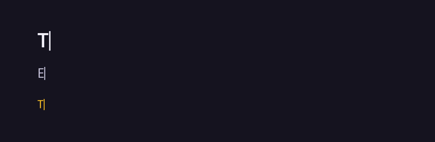
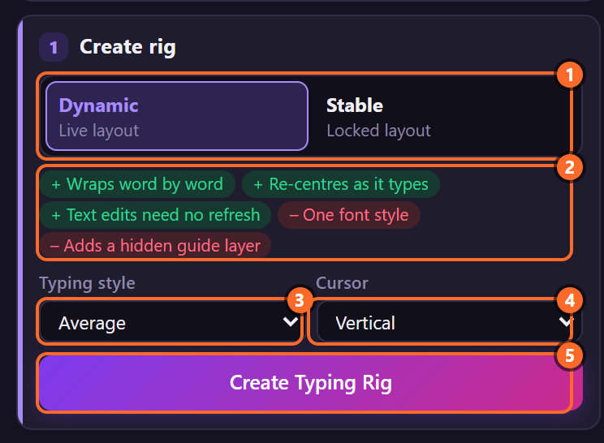
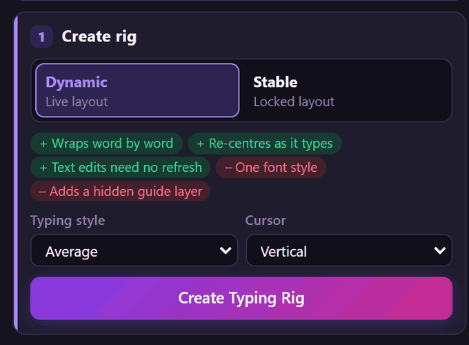
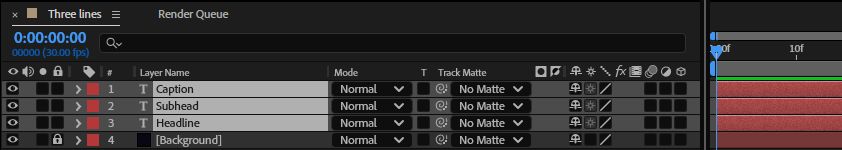
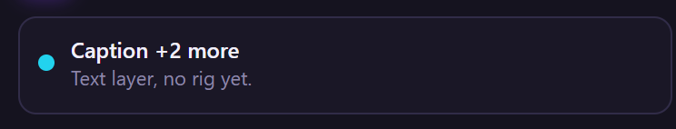
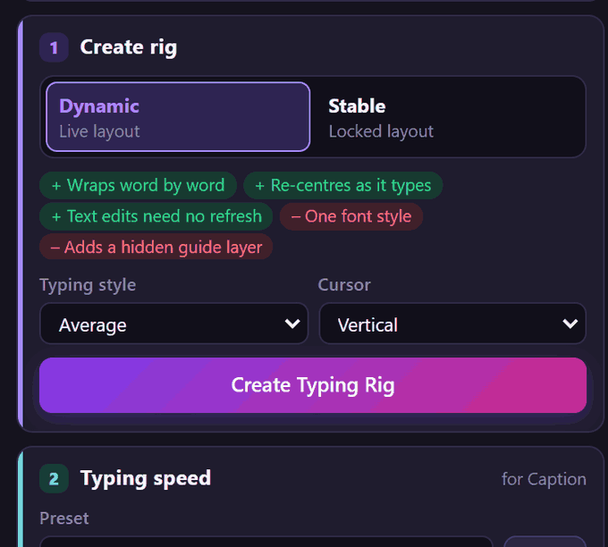
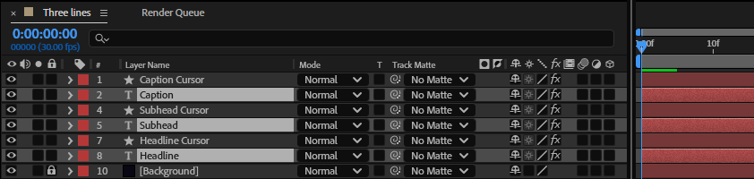

# 4. Creating a rig

**Create Typing Rig** turns selected text layers into typing text in one click: each gets the
controls, the typing expression and, if you want one, its own cursor layer.

## Where to find it

Card **1 · Create rig**:

1. **Rig type**: *Dynamic* (live layout) or *Stable* (locked layout). Chapter 3 compares them.
2. Under the choice, what that type does well (**+**) and what it gives up (**–**). They change with
   the choice:

   

3. **Typing style**: the typing preset the rig starts with (chapter 5). It is the same list as in
   *Typing speed*, and choosing in one chooses in the other.
4. **Cursor**: the cursor preset for the new cursor layer, or **No cursor** (you can add one later,
   chapter 12).
5. **Create Typing Rig**.

## Step by step

1. In the Timeline, select the text layers to rig. One or several: here three.

   

   The status line names one of them and how many more are selected:

   

2. Choose the rig type, the typing style and the cursor.
3. Click **Create Typing Rig**. The toast lists every layer that was rigged.

   

4. Press play (Space). Each layer types on from its own start.

Each text layer now has a cursor layer right above it and, for Dynamic, a guide right below it. The
guides are *shy*: with the comp's **Hide Shy Layers** switch on (the button at the top of the
Timeline), the Timeline lists only the texts and their cursors:

## What Create does

- Adds the 25 typing controls to each text layer (chapters 13 to 21), with the typing style's values.
- Puts the typing expression on the layer: on *Characters Shown* and a text animator for Stable, on
  *Source Text* for Dynamic (chapter 3).
- With a cursor: adds a shape layer named *‹layer› Cursor* above the text, parented to it (for
  Dynamic, to its guide), with the same in and out points and label colour (3D when the text is 3D),
  and its controls set from the cursor preset. The cursor takes the **colour of the text** (the
  yellow caption above has a yellow cursor; white when the text has no fill): *Use Text Color* is
  on, chapter 23.
- Measures the font where the time indicator is (for Stable, at every Source Text keyframe), so the
  cursor fits the text.
- All of it as one undo step, *LazyTyper: Create Typing Rig*.

The choices in the card are remembered for next time.

## What is skipped

A layer that cannot be rigged is left as it is, and the toast turns amber and says why. The others
are still rigged.

| Message | Why | What to do |
|---|---|---|
| *‹layer› already has a rig* | it was rigged before | change the rig with the other cards, or Remove it first (chapter 11) |
| *‹layer› has its own Source Text expression* | a Dynamic rig needs Source Text for its own expression | make a Stable rig, or take your expression off |

If an expression reports an error right after it is made, the toast shows it after the layer's name
(chapter 29).

## Tips and pitfalls

- **Select the cursor or guide of a rig** and the panel works on its text layer: selecting either
  is the same as selecting the text.
- **Rig at the time the text is finished** (or anywhere it has its final style): the font is
  measured there.
- **Change the font, size, tracking or box afterwards**: the panel turns amber; click Refresh
  (chapter 9).
- **Point text or paragraph text** both work. Paragraph (box) text is what makes a Dynamic rig wrap
  word by word.
- **A layer that should start typing later**: move its in point, or key Typing (chapter 6). Typing
  never runs before the layer starts.

## Related

- [3. How a rig works](03-how-a-rig-works.md)
- [5. Typing presets](05-typing-presets.md)
- [12. Cursor presets](12-cursor-presets.md)
