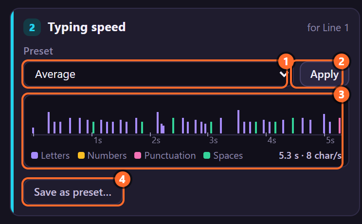
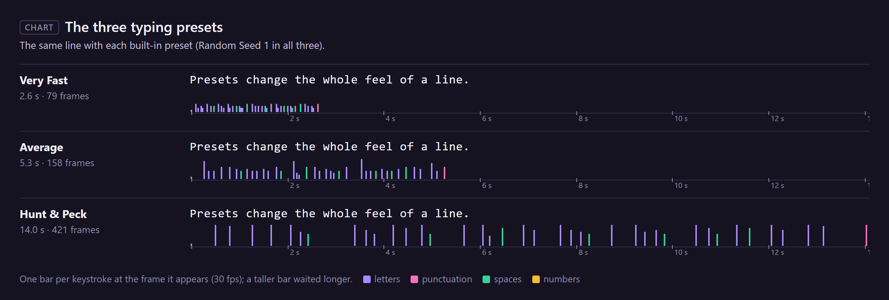
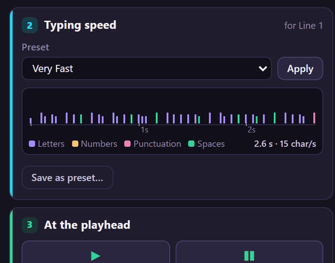
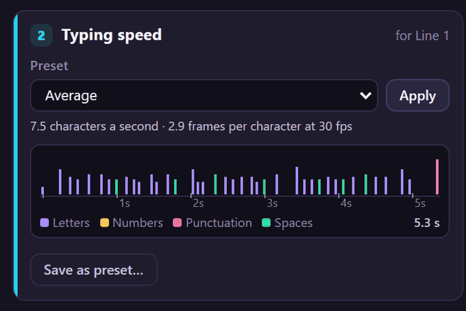
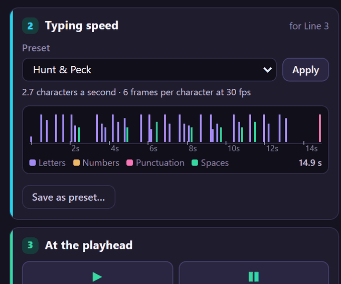
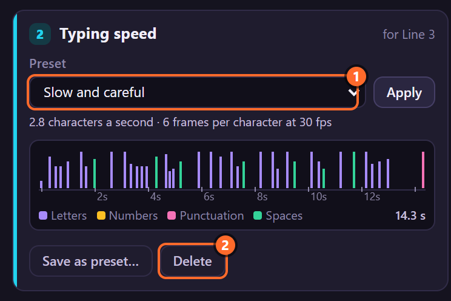
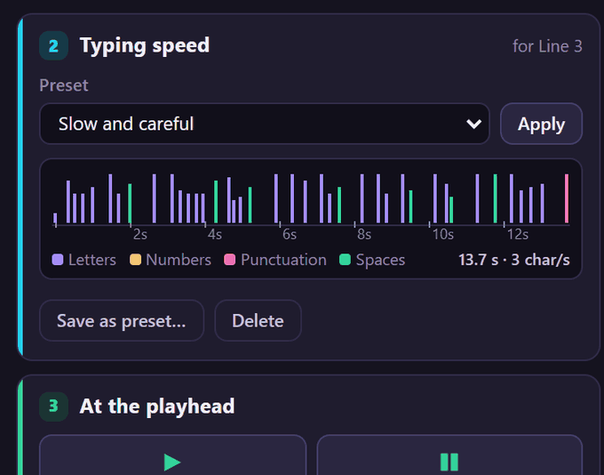

# 5. Typing presets

A **typing preset** is a whole set of speed values: the base speed, Variance, Random Seed and every
Slow, Fast and Slow/Fast control, and the frame rate they were made at. LazyTyper comes with three;
any rig's values can be saved as a preset of your own. A preset types as many characters a second in
a 24 fps comp as in a 60 fps one.

## Where to find it

Card **2 · Typing speed**:

1. **Preset**: built-in presets first, then your saved ones.
2. **Apply**: sets the selected rigs' controls to the preset.
3. **The rhythm strip**: what the preset does to the selected text. Above it, how many characters a
   second that is and the base speed in this comp's frames (*6.6 characters a second · 2.9 frames per
   character at 30 fps*).
4. **Save as preset…**: saves the selected rig's values as a preset of your own (**Delete** appears
   next to it when a saved preset is chosen).

The card's corner says which layer it is about (*for Line 1*).

## The three built-in presets

| | Very Fast | Average | Hunt & Peck |
|---|---|---|---|
| Frames Per Character (at 30 fps) | 2.05 | 2.9 | 6 |
| Variance | 15 | 35 | 60 |
| Slow: Capitals, Numbers, Symbols, Punctuation | 30, 30, 60, 20 | 60, 60, 120, 40 | 150, 120, 250, 80 |
| Slow: After Punctuation, Sentence End, Last Character | 150, 300, 100 | 250, 500, 150 | 300, 600, 100 |
| Slow: Before Line Break, New Line | 50, 250 | 60, 400 | 100, 500 |
| Slow: Word Start, Long Words, Rare Letters, Same Finger | 20, 0, 10, 40 | 50, 30, 40, 20 | 100, 60, 100, 0 |
| Fast: Repeated Letters, Capitals in a Row, Numbers in a Row | −25, 60, 50 | 15, 50, 40 | 60, 30, 40 |
| Fast: Common Pairs, Common Words, Word Momentum | 40, 30, 30 | 30, 20, 20 | 10, 20, 0 |
| Slow/Fast: Spaces, Empty Lines, Same Hand, Fatigue | −20, −60, 10, 0 | 0, −50, 20, 10 | −30, −40, 0, 20 |
| About, at any frame rate | 14 characters a second | 7 | 2.5 |

All three use Speed Mode *Frames Per Character* and Random Seed 1. **Average** is also what a new rig
gets when nothing else is chosen.

The three differ in more than speed. A very fast typist stumbles on a double letter (Repeated Letters
below 0) and on two letters typed by the same finger, and holds Shift through "NASA"; someone typing
with two fingers is already on the key for a double letter (Repeated Letters above 0) and hunts for
every capital.

## Apply a preset

1. Select the rigged text layers (one or several).
2. Choose the preset.
3. Click **Apply**. The toast says *Applied "Very Fast".*

A control that already has keyframes gets a keyframe at the time indicator instead of losing its
animation; the others simply change. Applying is one undo step.

## The rhythm strip

The strip types the selected layer's text with the chosen preset, before you apply it: one bar per
keystroke, coloured by what is typed (letters, numbers, punctuation, spaces), taller after a longer
wait, on a time scale in seconds at the comp's frame rate. On the right: the whole take. With no
text layer selected it types a sample sentence and says *sample*.

The line above the strip says how many characters a second that take is, and the base speed the
preset gets in this comp: *Frames Per Character* (or *Total Duration*) converted to the comp's frame
rate, with that rate. Hover it to see the frame rate the preset was made at.

The strip shows the preset's values, not the rig's current ones, and no pauses, Typing keyframes or
Start at Character: it is the preset's rhythm on that text.

## Save your own

1. Set up a rig the way you like it (Effect Controls) and select it.
2. Click **Save as preset…**, type a name, press **Save** (or Enter; Esc cancels).
3. The toast says *Saved "Slow and careful" from Line 3.* and the new preset is chosen.

The preset keeps the 28 speed controls at the time indicator: Speed Mode, Frames Per Character,
Total Duration, Variance, Random Seed and every Slow, Fast and Slow/Fast control, and the comp's frame
rate. Typing, Start at Character and Characters Shown belong to the shot, not the style, and are not
kept. Saving under a name that exists replaces that preset (*Updated "…"*).

## Frame rates

*Frames Per Character* and *Total Duration* count frames, and a frame is shorter at 60 fps than at
24. So a preset remembers the frame rate it was made at (30 fps for the built-in ones, the comp's for
your own) and, when you apply it or create a rig with it, LazyTyper converts those two to the comp's
frame rate. Everything else (Variance and every Slow, Fast and Slow/Fast control) is a percentage and
needs no converting.

| Very Fast in a comp at | Frames Per Character | Characters a second |
|---|---|---|
| 24 fps | 1.64 | 14 |
| 30 fps | 2.05 | 14 |
| 60 fps | 4.1 | 14 |

The rig itself still counts frames: change a comp's frame rate after rigging and its typing speeds
up or slows down; apply the preset again to convert it.

**Presets saved with LazyTyper 1.2.0 or earlier** did not keep a frame rate. They count as made at
30 fps, they get the controls added since at values that change nothing, so they type as before, and
the first time the panel opens it keeps a copy of the old file as `presets-before-1.3.json` next to
`presets.json`.

## Delete a saved preset

Choose it and click **Delete**. Built-in presets cannot be deleted (the button only shows for your
own). The list goes back to *Average*.

Saved presets are in `presets.json` in `%APPDATA%\LazyTyper` (Windows) or
`~/Library/Application Support/LazyTyper` (macOS): copy that file to take them to another computer.

## Tips and pitfalls

- **Apply sets Random Seed back to the preset's seed** (1 for the built-in ones). Save your own
  preset to keep a seed.
- **A keyframed Frames Per Character** gets a keyframe at the time indicator when you apply a
  preset; the other keyframes keep their frame counts.
- **Typing style in Create rig is the same choice** as this card's preset.
- **Matching a typist**: a fast typist has a quick base speed, low Variance, a few slow-downs and
  some speed-ups; a slow typist the opposite.

## Related

- [14. Speed Mode, Frames Per Character and Total Duration](14-speed.md)
- [15. Variance and Random Seed](15-variance-seed.md)
- Chapters [16](16-slow-characters.md) to [20](20-slow-fast.md): what each control in a preset does.
