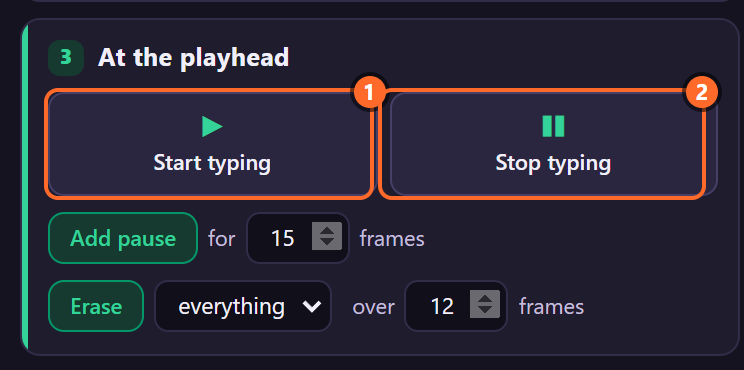
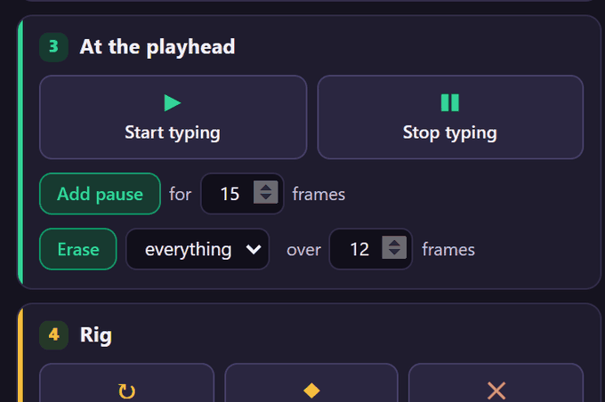
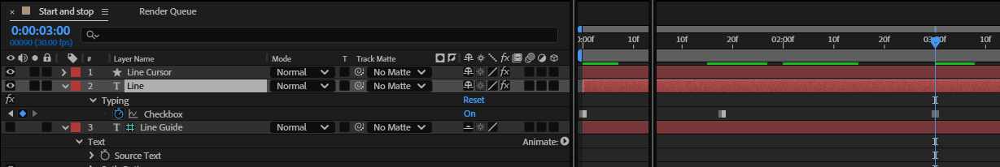

# 6. Start typing and Stop typing

**Stop typing** makes the typing wait at the time indicator; **Start typing** sets it going again.
Together they place typing on the timeline: to a beat, to a voice, around a cut.

*Rendered by After Effects: typing stops at 1.6 s and starts again at 3 s.*

## Where to find it

Card **3 · At the playhead**, the two big buttons:

## Step by step

1. Select the rigged text layer and put the time indicator where typing should stop (1.6 s here,
   after "Typing stops").
2. Click **Stop typing**. The toast says *Typing stops here.*

   

3. Move the time indicator to where typing should go on (3 s) and click **Start typing**: *Typing
   starts here.*

   

Both buttons key the **Typing** checkbox, which you can see with U:

## What the buttons key

- A keyframe on **Typing** at the time indicator: off for Stop, on for Start. A checkbox holds its
  value until the next keyframe.
- The first time Typing gets a keyframe, also a keyframe at the layer's start with the value it had,
  so the typing before stays as it was (the key at 0 s above).
- On every selected rig, as one undo step.

When typing starts again, **the next character appears at once**, the same frame: a key that was
waiting when typing stopped does not finish its wait. Typing then goes on at the rig's speed from
there.

## Tips and pitfalls

- **Start later than the layer**: Stop typing at the layer's start, then Start typing where it
  should begin. Or simply move the layer's in point: typing never runs before the layer starts.
- **A short break inside a line** is easier as a Pause marker (chapter 7): its length is a drag.
- **Stop is not Erase**: the text stays as it is. To take characters back, use Erase (chapter 8).
- **Several rigs**: select them all and click once; each gets its own keyframes.
- **Bake** (chapter 10) turns the result into keyframes; after that, Typing keyframes change nothing
  until you unbake.

## Related

- [7. Pauses](07-pauses.md)
- [8. Erase](08-erase.md)
- [13. Typing and Start at Character](13-typing-start-at-character.md)
