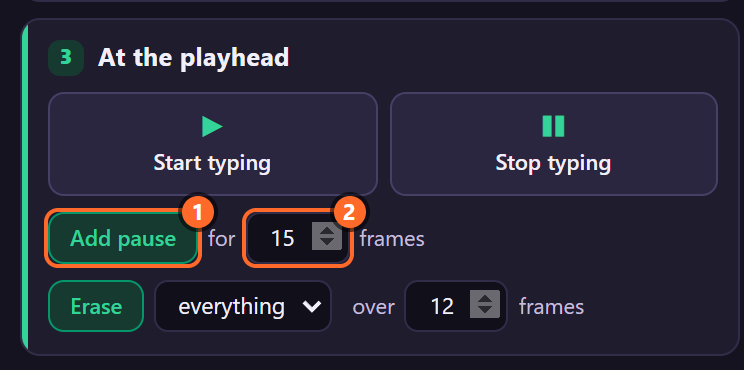
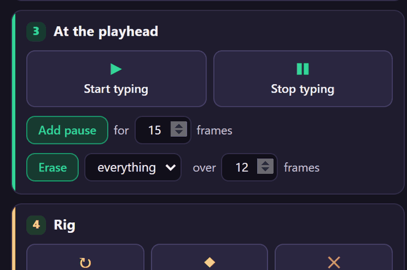
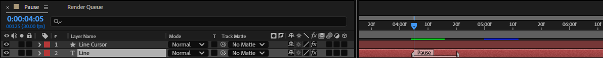
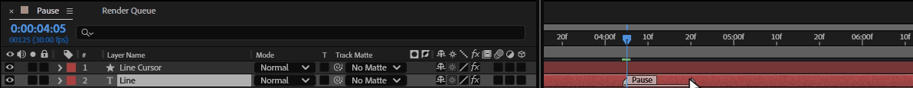
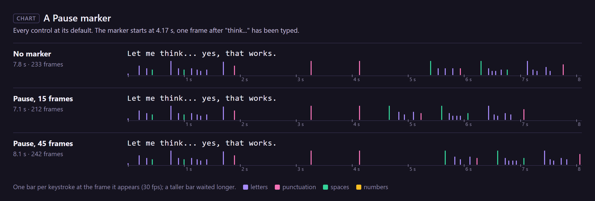

# 7. Pauses

A **pause** holds the typing for a while, the way someone stops to think. It is a layer marker named
*Pause* on the text layer, and it lasts as long as the marker: drag its end to make it longer.

## Where to find it

Card **3 · At the playhead**:

## Step by step

1. Select the rigged text layer and put the time indicator where the pause starts: here one frame
   after "think..." is typed (4.17 s).
2. Set **for … frames** (15 here; the default).
3. Click **Add pause**. The toast says *Pause of 15 frames added (a layer marker; drag its end to
   change it).*

   

4. The marker sits on the text layer, as long as the pause:

   

5. To change its length, drag the marker's end in the Timeline:

   

   *The marker's length changed in After Effects step by step; the pointer shows where to drag.*

## How the engine reads markers

Every marker on the **text layer** whose comment starts with **pause** (any case, spaces before it
allowed) is a pause:

| The marker | The pause lasts |
|---|---|
| has a length (a marker with a duration) | its length |
| has no length, and a number in the comment (*Pause 20*) | that many frames |
| has no length and no number (*Pause*) | 12 frames |

So you can also make pauses by hand: add a layer marker (*Layer › Markers › Add Marker*, or `*` on
the numeric keypad), double-click it and name it *Pause 20*.

While a pause lasts, nothing is typed. **When it ends, the next character appears at once**: the
pause stands in for that character's wait instead of being added to it. A pause that starts on the
very frame a character would appear holds that character back until it ends.

That is why a short pause can even make a take shorter. Here the character after "think..." waits
38 frames on its own (Sentence End, chapter 17). A 15-frame pause replaces that wait, so the take
ends at frame 212 instead of 233; with 45 frames it ends at 242.

## Tips and pitfalls

- **Put the marker on the text layer**, not the cursor: the rig only reads its own layer's markers.
- **A pause right after a sentence** can be shorter than you'd think: the engine already waits
  there (chapter 17). Keep Slow: Sentence End low if you place pauses by hand everywhere.
- **Several rigs selected**: each gets its own marker at the time indicator.
- **Markers stay** when you remove the rig (chapter 11).
- **Bake** keeps the pauses in the keyframes; after baking, moving a marker changes nothing until
  you unbake.

## Related

- [6. Start typing and Stop typing](06-start-stop.md)
- [17. Slow: After Punctuation, Sentence End, Last Character and line breaks](17-slow-after.md)
- [28. Recipes](28-recipes.md): speed keyed to a voice-over.
