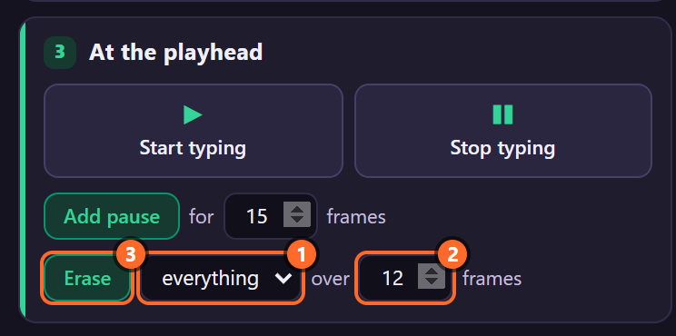
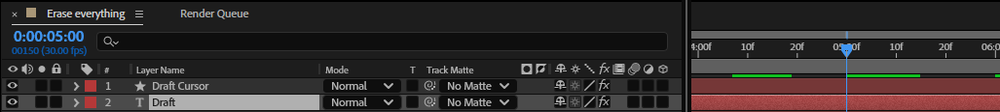
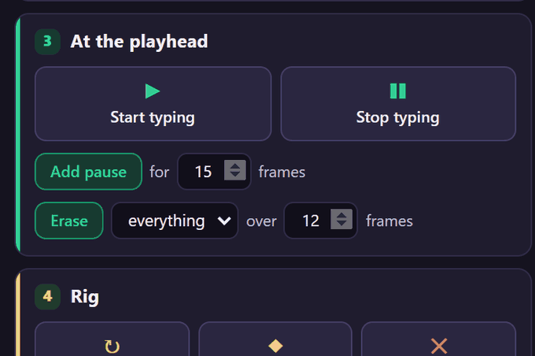
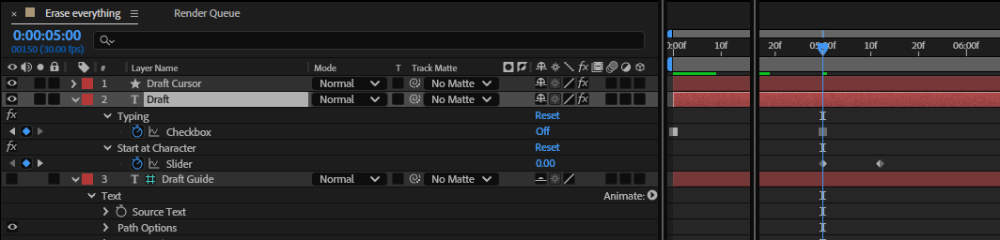
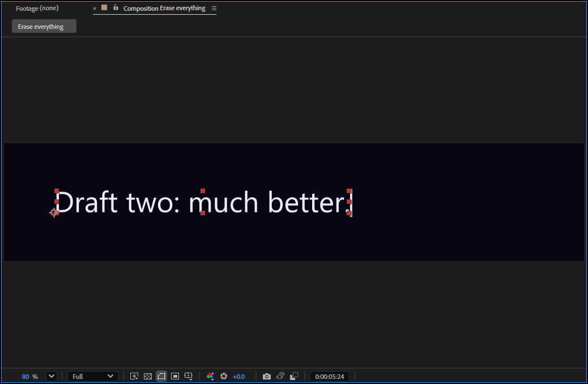
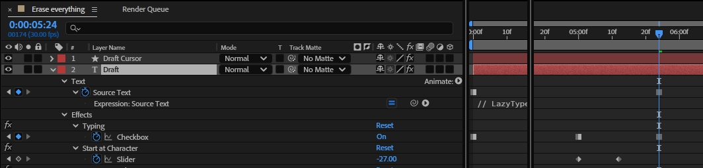
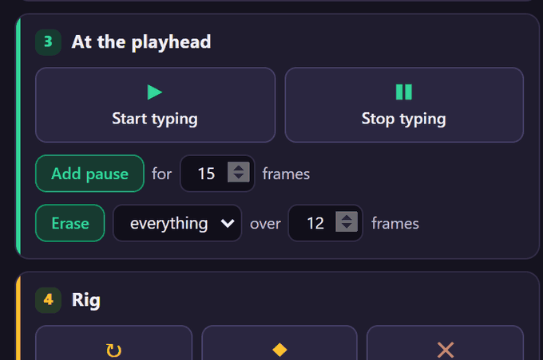
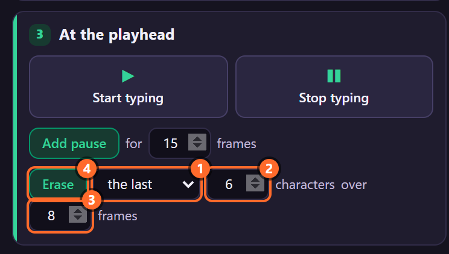

# 8. Erase

**Erase** deletes typed text the way a person does: backspace by backspace, from the end. It can
take everything back or only the last few characters, over as many frames as you choose. Then you
type something else in its place. That's how a line gets rewritten on screen, or a typo fixed.

*Rendered by After Effects at 30 fps: "Draft one: not quite right." types on, is erased over 12
frames from 5 s, and "Draft two: much better." types from 5.8 s.*

## Where to find it

In the panel, card **3 · At the playhead**, the last row:

1. **What to erase**: *everything*, or *the last* N characters (a field for N appears).
2. **Over** how many frames the erasing takes.
3. **Erase**: does it at the time indicator, on every selected rig.

The card is dimmed until a layer with a LazyTyper rig is selected (its text layer, its cursor or its
guide).

## Erase everything, step by step

1. In the Timeline, select the rig's text layer and put the time indicator where the erasing should
   start: here 5 s, after "Draft one: not quite right." has been typed.

   

2. In the panel, choose **everything** and set **over** to the number of frames the erasing takes
   (here 12), as in the picture above.
3. Click **Erase**. The toast says what happened: *Typing stops here and everything backspace away
   over 12 frames. Start typing again later to type on.*

   

4. Press **U** on the text layer to see what Erase keyed: **Typing** goes off at 5 s, and **Start
   at Character** goes from 0 at 5 s to −27 at 5.4 s (12 frames later), minus the 27 characters
   that were showing.

   

   Typing had no keyframes, so Erase also keyed it **on** at the layer's start (the key at 0 s):
   the typing before 5 s stays as it was.

The text is gone by 5.4 s and stays gone until you start typing again.

## Type something else in its place

1. Switch the Source Text expression off while you edit, so the Comp panel shows the text itself
   rather than the typed part: in the Timeline, click the **=** switch on *Expression: Source Text*.
   (A Stable rig has no Source Text expression: skip this and the switch back on in step 4.)
2. With the time indicator before the new text (0 s here), click the **stopwatch** of
   **Source Text**: a keyframe holds the old text.
3. Move to where the new text starts (5.8 s), and type the new text into the layer. After Effects
   adds a second Source Text keyframe.

   

   

4. Click the **=** switch again to turn the expression back on, then click **Start typing** in the
   panel (still at 5.8 s). Typing is keyed on at 5.8 s and the new text types from its first letter.

   

A **Stable** rig measures its cursor per Source Text keyframe, so after a text change the panel turns
amber and asks for a **Refresh**: click it (chapter 9). A Dynamic rig needs nothing.

## Erase only the last few characters

The same, with **the last** chosen: a field for the number of characters appears. Here the typo
"libary" is taken back (6 characters over 8 frames) and the word typed again correctly.

1. Put the time indicator after the typo is typed (3.4 s here).
2. Choose **the last**, type **6** in the characters field and **8** in *over … frames*.
3. Click **Erase**. "Meet me at the " is left.
4. Key the corrected text in Source Text at 3.9 s ("Meet me at the library"), as in the section
   above, and click **Start typing** at 3.9 s.

Typing goes on from where the text is now (15 characters), so only "library" types: the kept part
must be the same at the start of the new text.

## Every setting

| Setting | What it does |
|---|---|
| **everything** | Erases every character showing at the time indicator. |
| **the last** N **characters** | Erases N characters from the end (default 5). More than are showing erases what is showing. |
| **over** N **frames** | How long the erasing takes (default 12). The characters go evenly over these frames: 27 characters over 12 frames is two or three a frame, 6 over 8 is one most frames. |
| **Erase** | Keys it at the time indicator on every selected rig, as one undo step (*LazyTyper: Erase Here*). |

What Erase keys, exactly:

- **Typing** off at the time indicator (when Typing had no keyframes yet, also its old value at the
  layer's start, so nothing earlier changes).
- **Start at Character** twice: its value at the time indicator, and that value minus the characters
  to erase N frames later. The two keys are linear.

The rig shows *Start at Character + the characters typed so far*, rounded and kept between 0 and the
length of the text. As Start at Character falls, characters go from the end. Erase deletes nothing
from the text itself: the Source Text is untouched, and turning Typing back on goes on from what is
showing.

## Tips and pitfalls

- **Nothing happens on a baked rig.** Baking (chapter 10) turns *Characters Shown* into keyframes,
  and those no longer read Start at Character. Unbake (Shift+click Bake), erase, then bake again.
  In the baked keyframes, the erasing keystrokes get the *Deleting* label colour (red unless you
  change it in Settings).
- **The cursor holds still while erasing.** With *Blink While Typing* off, the cursor stays solid
  while the count changes and for 0.4 s after, then blinks again (chapter 24).
- **A different backspace rhythm**: ease the two Start at Character keys (select them, F9) to start
  slow and speed up. The rig rounds Start at Character, so any interpolation works.
- **Erasing when nothing is showing** keys Typing off; the two Start at Character keys get the same
  value, so nothing else changes.
- **Retyping after the last N** goes on from what is left, in the text at that time. If the new text
  differs before that point, those characters change at once rather than typing.
- **Start at Character is now negative** (−27 above): that is expected. It counts back the
  characters that were typed before.
- **Several rigs selected**: each erases its own showing characters, at the same time indicator.

## Related

- Chapter 6, *Start typing and Stop typing*: the Typing keyframes Erase uses.
- Chapter 13, *Typing and Start at Character*: deleting by hand with Start at Character.
- Chapter 10, *Bake and Unbake*: erasing on a baked rig.
- Chapter 28, *Recipes*: delete and retype.
