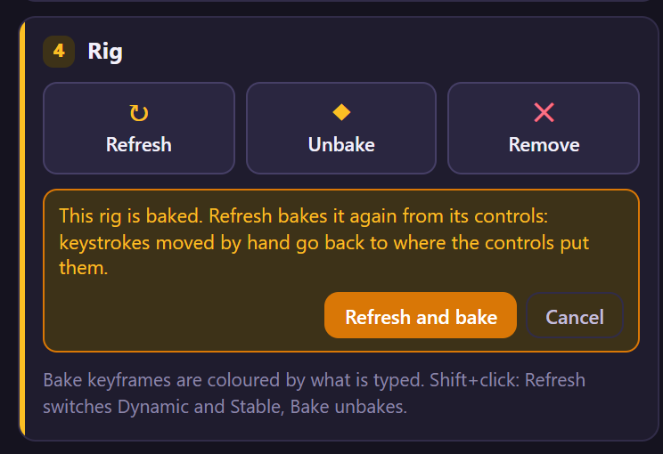
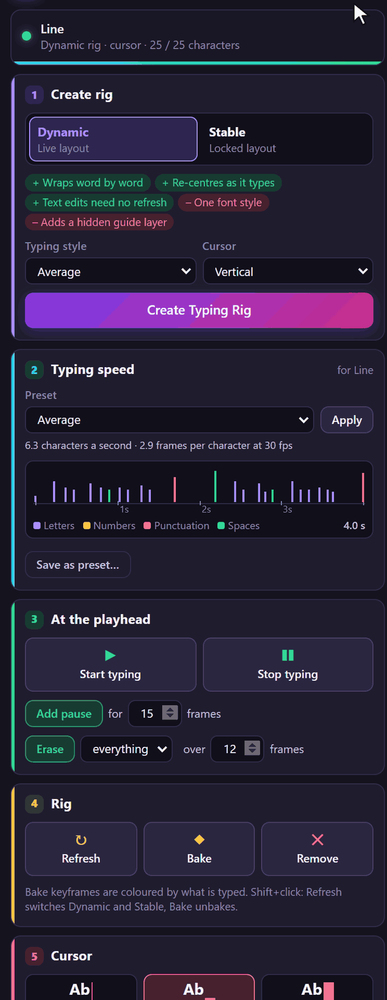

# 9. Refresh

A rig measures the text's font when it is made, so its cursor knows where the letters end. When you
change the font, the size or the layout afterwards, the cursor is measured for a text that is no
longer there. **Refresh** measures again and rebuilds the rig's expressions. The panel tells you
when it is needed.

*Rendered by After Effects at 4.2 s, when the line is typed.*

## When the panel asks for it

The status line turns amber, *⚠ The text or its style changed: click here to refresh the cursor.*,
and the Refresh button stands out:

It asks when any of these changed since the cursor was measured:

- the font, size, tracking, leading (or auto leading), alignment, faux bold or italic, all caps,
  small caps, horizontal or vertical scale, baseline shift;
- paragraph text or point text, and the paragraph box's size and position;
- for a **Stable** rig also the text itself, at any Source Text keyframe (a Stable rig's cursor
  follows points measured on the finished layout);
- for a cursor that takes the text's colour (**Use Text Color**, chapter 23), the text's colours.

A Dynamic rig follows text changes by itself, so changing its words never needs a Refresh.

## Step by step

1. Select the rig (its text layer, cursor or guide).
2. Click the amber status line, or **Refresh** in card 4 · Rig. The toast says *Refreshed Line.*

## What Refresh does

- Writes every expression of the rig again (useful after updating LazyTyper, too).
- Adds any control a newer LazyTyper has and the rig lacks, in its place in Effect Controls and at a
  value that changes nothing, leaving your values alone. A rig made with 1.2.0 gets the six controls
  of chapters 17 to 19 and keeps its timing; its cursor gets Show Cursor, Use Text Color (off, so it
  keeps its Cursor Color), Size From, the two Follow switches and Offset Unit (Pixels), and looks as
  it did. Its old Text Layer and Guide Layer controls go (chapter 22).
- Measures the font where the time indicator is, and for a Stable rig the cursor's points, sizes and
  colours at every Source Text keyframe.
- Makes the guide layer of a Dynamic rig again, with the cursor under it.
- Bakes a baked rig again (below).

All as one undo step, *LazyTyper: Refresh Rig*, on every selected rig.

## A baked rig

Refresh on a baked rig (chapter 10) unbakes it, rebuilds it and bakes it again from its controls, so
the keyframes follow the text you changed. Keystrokes you moved by hand go back to where the controls
put them, so the panel asks first, in the Rig card:

**Refresh and bake** goes ahead; the toast says *Refreshed Line. Baked again: Line.* **Cancel**
leaves the rig as it is. To keep hand-moved keystrokes, don't refresh a baked rig: unbake, change,
bake and move them again.

## Switch between Dynamic and Stable

**Shift+click Refresh** turns each selected rig into the other type: a Dynamic rig becomes Stable, a
Stable one Dynamic. Every typing control and every cursor control keeps its value, and so does the
typing; only the parts that differ between the two are made anew (the guide, the text animator, the
expressions). The toast says *Switched Line to Stable.*

- A **Stable** rig with mixed fonts, sizes or colours shows only its first style as **Dynamic** (a
  Dynamic rig types into one style). The toast says so; switching back brings the styles back,
  since they stay in the text.
- A Stable rig whose Source Text has an expression of your own cannot become Dynamic (the toast says
  *… has its own Source Text expression*).
- A baked rig is baked again after the switch, after the same question as above.

One undo step, *LazyTyper: Switch Rig Type*.

## Tips and pitfalls

- **Refresh at a time when the text has its final style.** A rig reads the text's first style; for a
  Dynamic rig the style is checked at the layer's end.
- **The cursor sits in the wrong place but the panel is not amber**: the change may be one the panel
  does not look at (an animator of your own, say). Refresh anyway; it is harmless. For a Stable
  rig the panel also notices a font, size or tracking change on part of the text, because that
  moves the lines. A colour change is flagged only while the cursor uses the text's colour.
- **Several rigs**: select them all and refresh once.

## Related

- [3. How a rig works](03-how-a-rig-works.md)
- [2. The panel at a glance](02-panel-at-a-glance.md): the status line.
- [29. When something goes wrong](29-troubleshooting.md)
