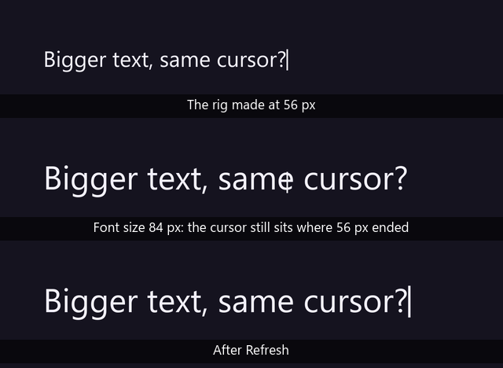
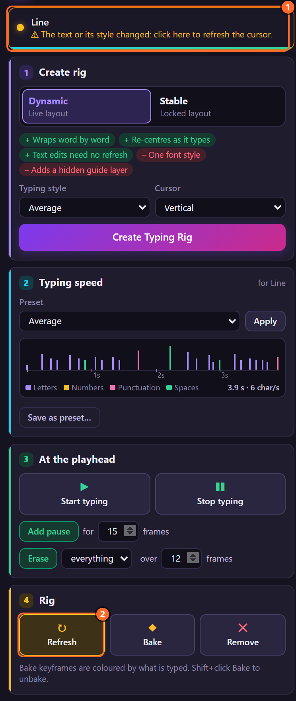
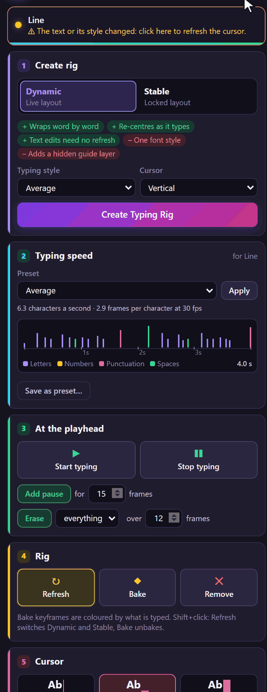

# 9. Refresh

A rig measures the text's font when it is made, so its cursor knows where the letters end. When you
change the font, the size or the layout afterwards, the cursor is measured for a text that is no
longer there. **Refresh** measures again and rebuilds the rig's expressions. The panel tells you
when it is needed.

*Rendered by After Effects at 4.2 s, when the line is typed.*

## When the panel asks for it

The status line turns amber, *⚠ The text or its style changed: click here to refresh the cursor.*,
and the Refresh button stands out:

It asks when any of these changed since the cursor was measured:

- the font, size, tracking, leading (or auto leading), alignment, faux bold or italic, all caps,
  small caps, horizontal or vertical scale, baseline shift;
- paragraph text or point text, and the paragraph box's size and position;
- for a **Stable** rig also the text itself, at any Source Text keyframe (a Stable rig's cursor
  follows points measured on the finished layout).

A Dynamic rig follows text changes by itself, so changing its words never needs a Refresh.

## Step by step

1. Select the rig (its text layer, cursor or guide).
2. Click the amber status line, or **Refresh** in card 4 · Rig. The toast says *Refreshed Line.*

## What Refresh does

- Writes every expression of the rig again (useful after updating LazyTyper, too).
- Adds any control a newer LazyTyper has and the rig lacks, leaving your values alone.
- Measures the font where the time indicator is, and for a Stable rig the cursor's points at every
  Source Text keyframe.
- Makes the guide layer of a Dynamic rig again.
- Keeps a baked rig baked.

All as one undo step, *LazyTyper: Refresh Rig*, on every selected rig.

## Tips and pitfalls

- **Refresh at a time when the text has its final style.** A rig reads the text's first style; for a
  Dynamic rig the style is checked at the layer's end.
- **The cursor sits in the wrong place but the panel is not amber**: the change may be one the panel
  does not look at (a style on part of the text, an animator of your own). Refresh anyway; it is
  harmless.
- **Several rigs**: select them all and refresh once.

## Related

- [3. How a rig works](03-how-a-rig-works.md)
- [2. The panel at a glance](02-panel-at-a-glance.md): the status line.
- [29. When something goes wrong](29-troubleshooting.md)
