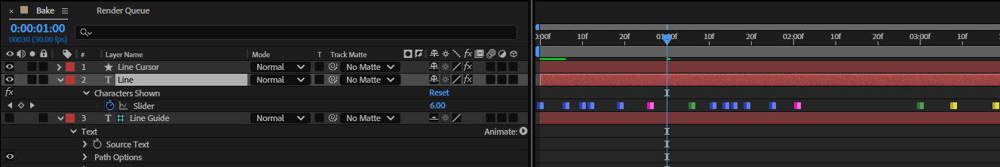
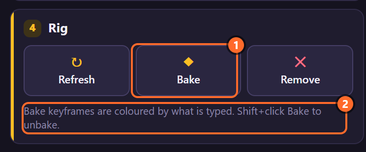
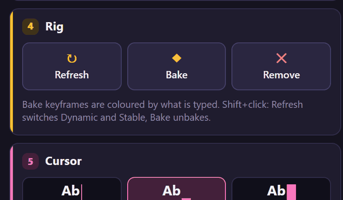
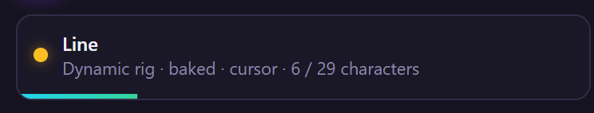
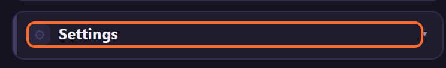
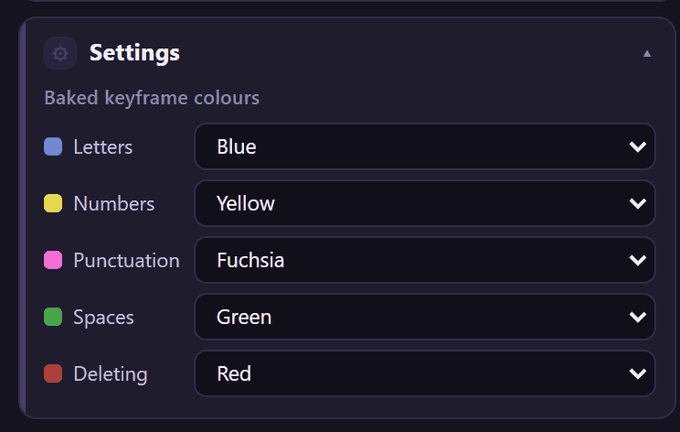
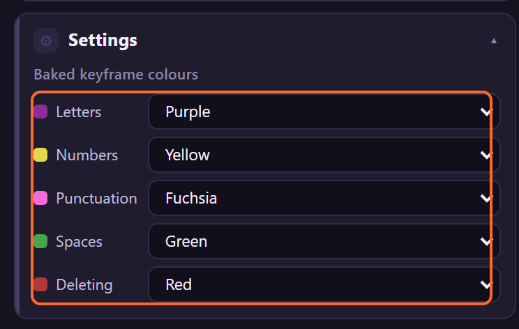
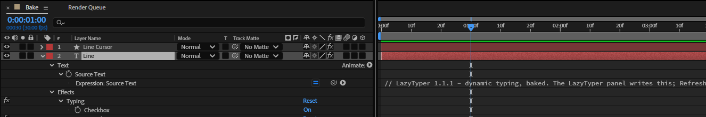
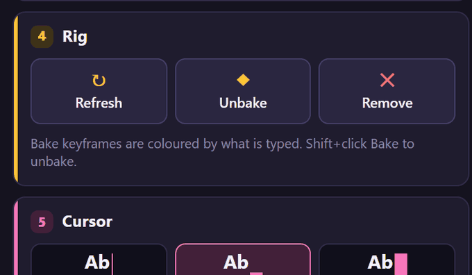

# 10. Bake and Unbake

**Bake** turns a rig's typing into keyframes: one hold keyframe on *Characters Shown* for every
keystroke, coloured by what was typed. Baked typing plays instantly however long the text, and every
keystroke can be moved by hand. **Unbake** (Shift+click) brings the live rig back.

## Where to find it

Card **4 · Rig**, the middle button; the note under the buttons is a reminder of Shift+click:

## Bake, step by step

1. Select the rigged text layers (one or several).
2. Click **Bake**. The toast says how many keyframes each layer got, *Baked Line (29 keyframes).
   Shift+click Bake to unbake.*, and the button now reads **Unbake**.

   

3. The status line says *baked*:

   

4. Press U to see the keyframes (the picture at the top). Move any of them, or several, to change
   the timing by hand ([chapter 28](28-recipes.md#nudge-baked-keystrokes)).

## What Bake does

- Runs the engine once from the layer's start to its end, exactly as the live rig would play
  (pauses, Typing keyframes, Erase and Variance included).
- Puts a **hold** keyframe on *Characters Shown* wherever the count changes, and removes its
  expression.
- Gives each keyframe a **label colour** by the character just typed (below). A keyframe where the
  count goes down is *Deleting*.
- A Dynamic rig's Source Text now reads those keyframes instead of running the engine.
- One undo step, *LazyTyper: Bake Typing*. A rig that is already baked is skipped
  (*… is already baked*).

| Kind | Which characters | Default colour |
|---|---|---|
| Letters | letters of any script, and any other character outside ASCII (so also "…" or "।") | Blue |
| Numbers | 0-9 | Yellow |
| Punctuation | every other ASCII character: `. , ; : ! ? ' " - ( ) [ ]` and symbols such as `@ # & %` | Fuchsia |
| Spaces | spaces, tabs, line breaks | Green |
| Deleting | the count went down (Erase, Start at Character lowered) | Red |

The colours are keyframe labels: LazyTyper sets them when your After Effects has keyframe labels, and
bakes without them otherwise.

## The colours, in Settings

Open **Settings** at the bottom of the panel:

Choose a colour for each kind. Here Letters changes from Blue to Purple:

The colours apply to the next Bake; keyframes already baked keep theirs. After unbaking and baking
again with Letters set to Purple:

## Unbake

**Shift+click Bake**, or click the button while it reads **Unbake**. The toast says *Back to live
typing. Keyframe timing changes are gone.*: the keyframes are removed and the rig's expressions come
back, so changes you made to the keyframes are lost.

## Tips and pitfalls

- **After baking, the controls do nothing**: Variance, speed, presets, Erase, Start typing and
  Pause markers no longer change the typing until you unbake. Bake last.
- **Long texts** play much faster baked, in both expression engines.
- **To retime one stretch**: bake, select the keyframes from that keystroke on, drag them.
- **Unbake loses hand edits**: save a copy of the layer first if you might want them back.
- **Deleting keys after an Erase** are red by default: an easy way to find them in the Timeline.

## Related

- [8. Erase](08-erase.md)
- [21. Characters Shown](21-characters-shown.md)
- [28. Recipes](28-recipes.md): nudging baked keystrokes.
