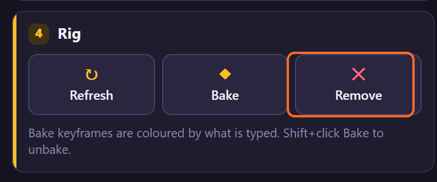
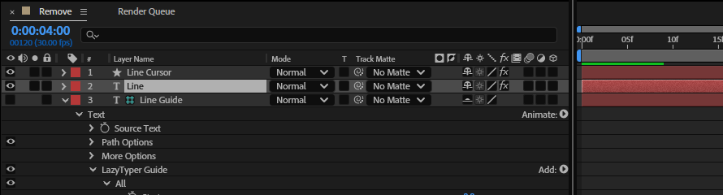
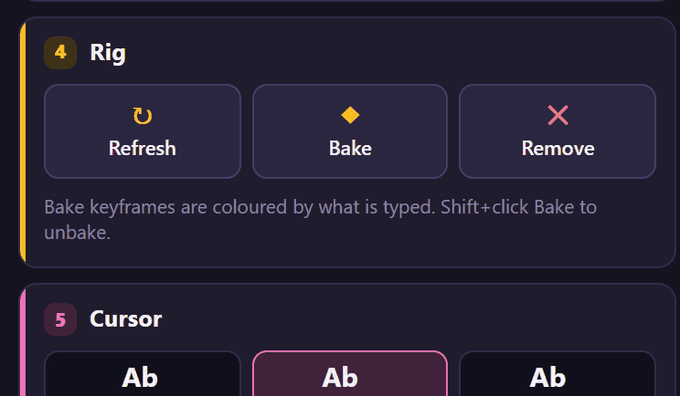
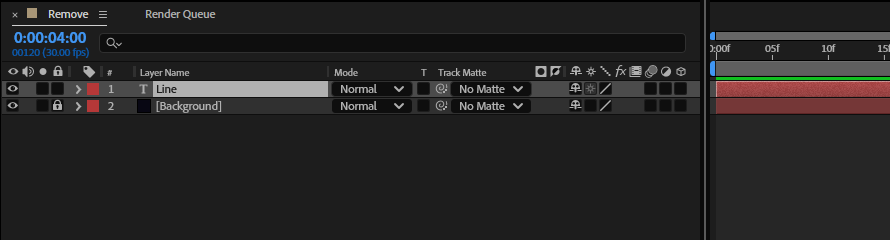

# 11. Remove

**Remove** takes a rig off its text layer: the cursor and guide layers go, and so do the rig's
controls, expression and animator. The text layer stays, showing all its text.

## Where to find it

Card **4 · Rig**, the red button on the right:

## Step by step

1. Select the rigged text layers (or their cursors or guides).

   

2. Click **Remove**. The toast says *Removed the rig from Line.*

   

3. Only the text layer is left:

   

## What goes, what stays

| Goes | Stays |
|---|---|
| the cursor layer (*LazyTyper cursor*) | the text layer and its text, style and transform |
| the guide layer (*LazyTyper guide*) | Source Text keyframes |
| the Source Text expression, if it is LazyTyper's | an expression of your own on Source Text |
| the **LazyTyper** text animator | your own animators |
| the 25 typing controls, and their keyframes | layer markers (Pause markers too) |

One undo step, *LazyTyper: Remove Rig*: Edit › Undo brings the whole rig back.

## Tips and pitfalls

- **A baked rig** is removed the same way; its keyframes go with *Characters Shown*.
- **To start over with other settings**, Remove and Create again: a layer that already has a rig is
  skipped by Create.
- **Pause markers stay** on the layer; delete them by hand if you don't need them.
- **Deleting the cursor layer by hand** leaves the rig typing without a cursor: Add cursor gives it
  a new one (chapter 12).

## Related

- [4. Creating a rig](04-create-rig.md)
- [12. Cursor presets](12-cursor-presets.md): Add cursor.
