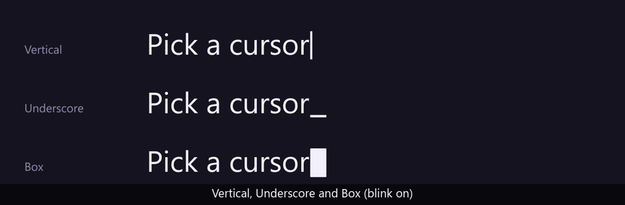
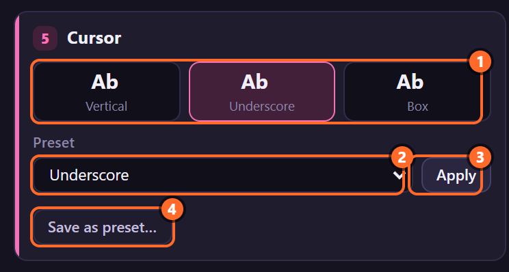
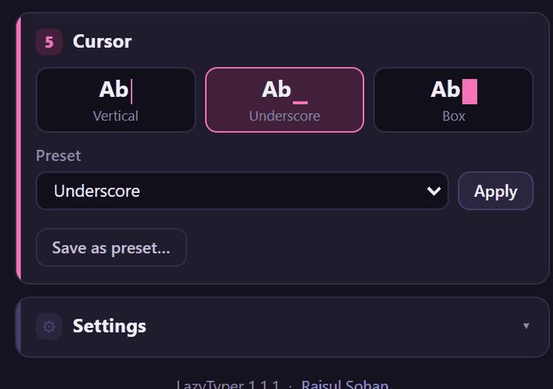
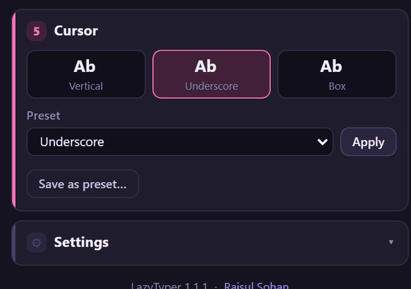
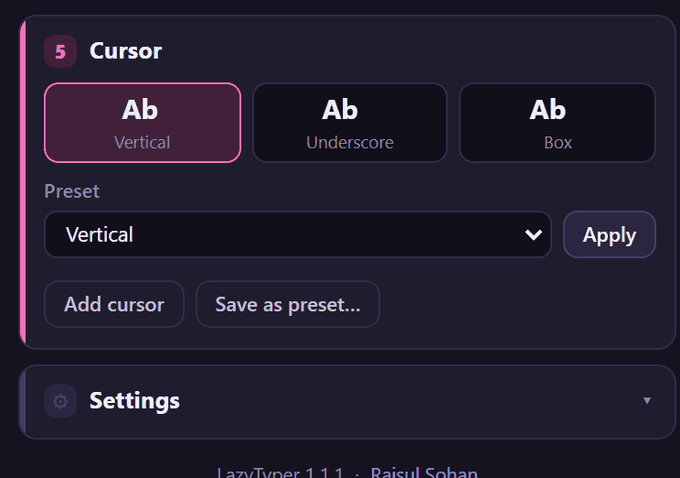
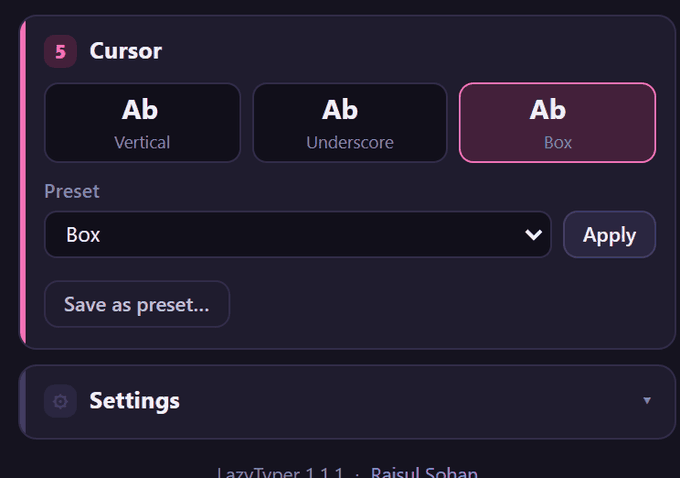

# 12. Cursor presets

A **cursor preset** is a whole cursor shape and blink: width, top, bottom, how it follows mixed font
sizes, corners, offsets, opacity and blink settings. LazyTyper comes with three; any rig's cursor can be saved as a preset of
your own.

## Where to find it

Card **5 · Cursor**:

1. **Previews** of up to six presets, drawn after an "Ab". Clicking one chooses it in the list (it
   does not apply it yet).
2. **Preset**: built-in presets, then your saved ones.
3. **Apply**: sets the selected rigs' cursors to the preset.
4. **Save as preset…**: saves the selected rig's cursor as a preset (**Delete** appears next to it
   for a saved preset). **Add cursor** appears here too when the selected rig has no cursor.

## The three built-in presets

| | Vertical | Underscore | Box |
|---|---|---|---|
| Width | 7 | 55 | 55 |
| Top | 80 | −6 | 80 |
| Bottom | 16 | 14 | 18 |
| Width Follows Size | off | on | on |
| Roundness (all four corners) | 0 | 0 | 8 |

All three: Cursor Opacity 100, Blink on at 1 per second, Blink While Typing off, Blink Softness 0,
Size From Character Before, Height Follows Size on, Individual Corners off, Offset Unit % of Font
Size, no offsets. Sizes are percentages of the font size (chapter 25). Beside a bigger word all three
grow taller; the Vertical bar keeps its width, Underscore and Box grow wider too.

## Apply a preset

1. Select the rigged text layers.
2. Choose the preset in the list, or click its preview.
3. Click **Apply**. The toast says *Cursor set to "Underscore".*

A preset sets 20 cursor controls: everything but **Show Cursor**, **Use Text Color** and **Cursor
Color**, so the colour stays as it is (by default the text's colour, chapter 23). A control with keyframes gets a keyframe at the time
indicator. One undo step.

## Add a cursor to a rig without one

A rig made with **No cursor** (or whose cursor layer was deleted) shows **Add cursor**:

1. Select the rig.
2. Choose the cursor preset to start from.
3. Click **Add cursor**. The toast says *Cursor added.*

The new cursor is measured and set up exactly as Create would have made it.

## Save and delete your own

1. Shape a rig's cursor in Effect Controls (chapters 23 to 27) and select the rig.
2. Click **Save as preset…**, type a name, press **Save** (Enter; Esc cancels): *Saved "Fat block"
   from Line 3.*
3. **Delete** removes the chosen saved preset; the list goes back to *Vertical*.

Saved cursor presets are in the same `presets.json` as the typing presets (chapter 5). A cursor preset
saved with LazyTyper 1.2 or earlier gets the newer controls the first time the panel opens, at values
that keep its look: Size From Character Before, both Follow switches on, and its offsets in Pixels.

## Tips and pitfalls

- **The colour is not part of a preset**: set Use Text Color and Cursor Color on the cursor layer
  (chapter 23).
- **Clicking a preview only chooses**: press Apply to change the rig.
- **Several rigs**: select them all and Apply once.

## Related

- Chapters [23](23-cursor-colour.md) to [27](27-cursor-offset.md): every cursor control.
- [4. Creating a rig](04-create-rig.md): the cursor a rig starts with.
