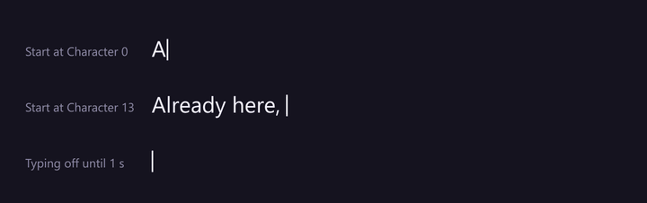
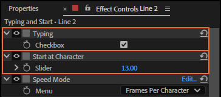
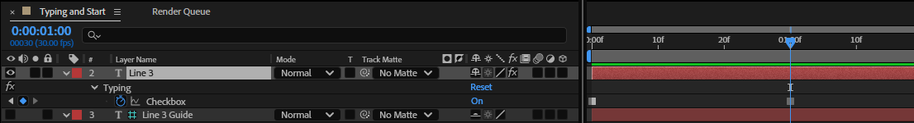
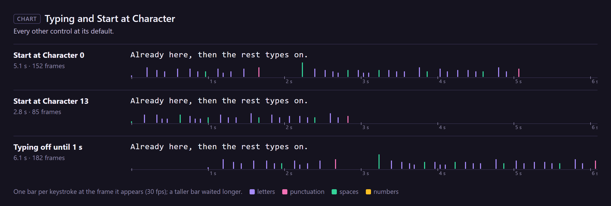

# 13. Typing and Start at Character

The first two controls on a rigged text layer say **when** typing runs and **from where**.

## Where to find them

At the top of the text layer's Effect Controls:

## Typing

A checkbox. Typing runs while it is on and waits while it is off. Keyframe it to stop and start
(the panel's *Stop typing* and *Start typing* do exactly that, chapter 6):

- Each time Typing goes on, **the next character appears at once**, on that frame; the following
  ones take their normal time.
- Typing never runs before the layer's in point.
- A Pause marker switches typing off for its length too (chapter 7).

## Start at Character

How many characters are already showing when typing begins. The rig shows
*Start at Character + the characters typed so far*, rounded, and never fewer than 0 or more than the
text has.

- **Raise it** to start with part of the text already there: at 13, "Already here," shows from the
  first frame and the rest types on (above). The take is shorter: 85 frames instead of 152.
- **Lower it while Typing is off** to delete characters from the end. Erase keys exactly that
  (chapter 8). It can go below 0: it then counts back characters that were typed.
- **Raise it while typing** and the text jumps ahead by that many characters.

## Every setting

| Control | Values | Default |
|---|---|---|
| **Typing** | on or off | on |
| **Start at Character** | any whole number (fractions are rounded) | 0 |

## Tips and pitfalls

- **Typing off from the start and nothing shows**: that's expected while Start at Character is 0.
  Set Start at Character to the text's length to show it all, or switch Typing on.
- **Delete and retype**: Erase (chapter 8) keys both controls for you.
- **After baking** neither control changes anything until you unbake (chapter 10).

## Related

- [6. Start typing and Stop typing](06-start-stop.md)
- [8. Erase](08-erase.md)
- [21. Characters Shown](21-characters-shown.md)
