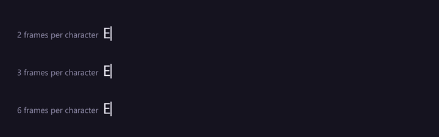
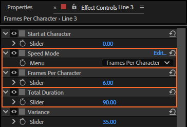
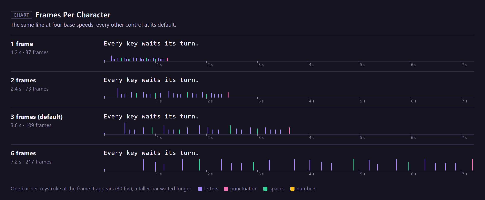
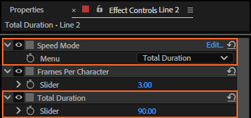
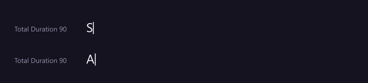
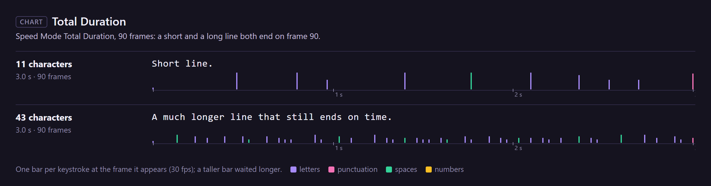

# 14. Speed Mode, Frames Per Character and Total Duration

The **base speed** is what every other speed control works on. Set it as a pace, **Frames Per
Character**, or as a length, **Total Duration**: the whole take in so many frames.

## Where to find them

In the text layer's Effect Controls, after Start at Character:

**Speed Mode** chooses which of the two the rig uses: *Frames Per Character* (the default) or
*Total Duration*. The other one is ignored.

## Frames Per Character

How many frames a plain character waits before it appears. Every character's own weight (Variance and
the Slow, Fast and Slow/Fast controls) multiplies it, so 3 does not mean every key takes exactly 3
frames: it is the pace the others are measured against.

| Frames Per Character | "Every key waits its turn." (25 characters, defaults otherwise) |
|---|---|
| 1 | 37 frames |
| 2 | 73 frames |
| 3 (default) | 109 frames |
| 6 | 217 frames |

**Fractions are exact.** The engine keeps the part of a frame that is left over and carries it to the
next character. With every other control at 0, 2.2 frames per character types on frames 0, 3, 5, 7,
9, 11, 14, 16…: waits of 2 and 3 frames that average 2.2. Below 1, several characters can appear on
the same frame: at 0.5, two a frame.

The time a character takes never goes below 0.02 frames, so even 0 is a very fast typist, not an
error.

## Total Duration

The whole take in **frames** (not seconds): the first character appears at once, and the rest share
the duration out by their weights, so the rhythm is the same as in Frames Per Character mode, only
stretched or squeezed to fit.

The duration is worked out **when typing starts** (and each time it starts again after Stop typing,
a pause or Typing off), for the characters still to type, with the text and controls at that moment.
So keyframing Total Duration in the middle of a run changes nothing until the next run; keyframe
Frames Per Character instead to speed up or slow down inside a run.

## Every setting

| Control | Values | Default |
|---|---|---|
| **Speed Mode** | Frames Per Character, Total Duration | Frames Per Character |
| **Frames Per Character** | frames, fractions allowed | 3 |
| **Total Duration** | frames | 90 |

## Tips and pitfalls

- **Matching a voice-over**: Total Duration fits a line to a phrase; for changes of pace inside a
  line, keyframe Frames Per Character ([chapter 28](28-recipes.md#speed-keyed-to-a-voice-over)).
- **Pauses in Total Duration mode** start a new run, which shares the duration out again over what
  is left: the take then lasts longer than the duration.
- **Comp frame rate**: both controls count frames, so the same values type faster in a 60 fps comp.

## Related

- [5. Typing presets](05-typing-presets.md)
- [15. Variance and Random Seed](15-variance-seed.md)
- [13. Typing and Start at Character](13-typing-start-at-character.md)
