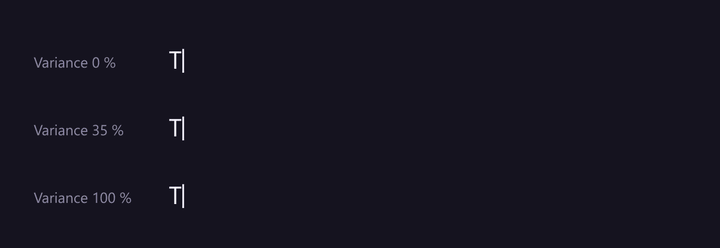
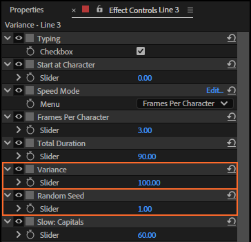
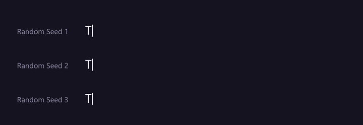
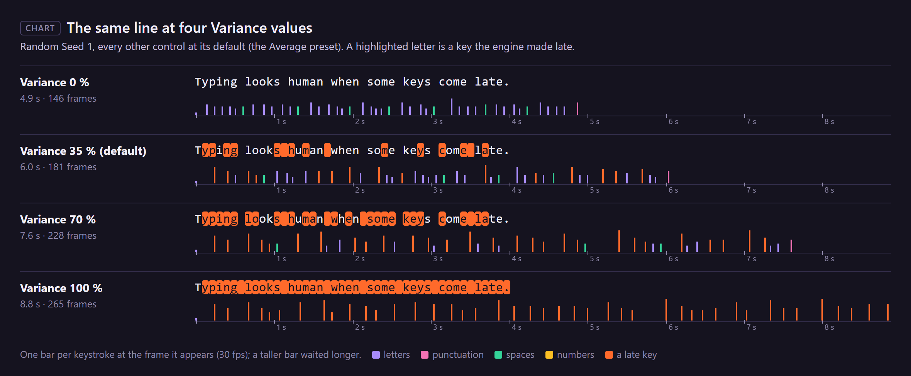
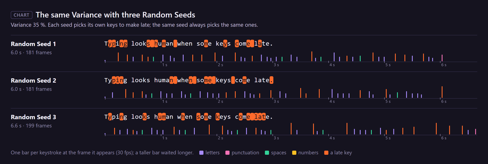
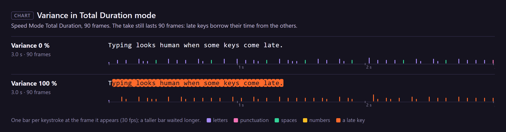

# 15. Variance and Random Seed

Nobody types every key at the same pace. Some keys come late: a finger is in the wrong place, the
eye checks the screen. **Variance** sets how often that happens; **Random Seed** chooses which keys.
The result looks natural and is still the same on every render, because the "random" choice comes
from the seed, never from chance.

*Rendered by After Effects at 30 fps, every other control at its default. At 0 % the line keeps an
even pulse (word starts and the full stop still take longer, from their own controls); at 100 %
every key comes late and the take is 1.8 times as long.*

## Where to find it

Both are controls on the rig's **text layer**, in Effect Controls, under the speed controls:

| Typing preset | Variance | Random Seed |
|---|---|---|
| Very Fast | 15 | 1 |
| Average (also a new rig's default) | 35 | 1 |
| Hunt & Peck | 60 | 1 |

## Step by step

1. Select the rig's text layer. Its controls show in **Effect Controls** (Window › Effect Controls,
   or F3), as in the picture above.
2. Set **Variance**: drag the value or click it and type a number, 0 to 100.
3. Play. To keep this rhythm but move the late keys elsewhere, change **Random Seed**.

*Rendered by After Effects: three seeds at Variance 35 %. The same keys are late on every render; a
new seed picks others.*

## What the engine does

For every character, the engine first works out its time from the base speed and the slow-down and
speed-up controls (chapters 14 and 16 to 20). Then Variance has its say:

- A character is **late** with a chance of Variance %: at 35 %, about one key in three; at 100 %,
  every key. Values above 100 act as 100, values below 0 as 0.
- A late key takes **1.25 to 2.5 times** its time: 25 to 150 % longer, a different amount for each.
  The lateness multiplies whatever the other controls already gave that key, so a late capital is
  later still.
- Which keys are late, and by how much, is decided by **Random Seed and the character's position**
  in the text: character 12 with seed 1 is always the same. Same text, same seed: the same take.
- The **first character** of a run (the first key, or the first after Start typing) appears at once
  and is never late.

In numbers, for the line in the chart (44 characters at 30 fps, every other control at its default):

| Variance | Late keys (of 43) | The take |
|---|---|---|
| 0 % | 0 | 4.9 s (146 frames) |
| 35 % | 15 | 6.0 s (181 frames) |
| 70 % | 28 | 7.6 s (228 frames) |
| 100 % | 43 | 8.8 s (265 frames) |

### Random Seed

Any number works, fractions too: 1, 2 and 1.5 give three different sets of late keys. A seed does
not make a take faster or slower on purpose; it only moves the late keys around, so the length can
change a little (here seeds 1 and 2 give 181 frames, seed 3 gives 199).

### In Total Duration mode

With **Speed Mode** set to *Total Duration* (chapter 14), the take lasts that duration whatever the
Variance: the engine shares the time out over the characters' weights, late keys included, so late
keys take their extra time from the others.

## Every setting

| Control | Range | What it does |
|---|---|---|
| **Variance** | 0-100 (%) | The chance that a key comes late. 0: never. 100: every key. |
| **Random Seed** | any number | Which keys are late and by how much. Change it for another take with the same feel. |

Both can be keyframed. A key's time is worked out when that key starts its wait, with the values at
that moment, so a Variance keyframe in the middle of a line changes the keys after it.

## Tips and pitfalls

- **Applying a typing preset sets Random Seed back to 1** (all three built-in presets store seed 1).
  Set your seed again after applying one, or save your own preset (chapter 5): it keeps the seed.
- **Several lines that should not type in step**: rig them together, then give each a different
  Random Seed.
- **Editing the text moves the luck.** Lateness belongs to positions, not letters: put a word in at
  the start and the late keys fall on other letters.
- **A very even rhythm reads as a machine**; above about 70 % a line starts to look hesitant. The
  presets use 15 (Very Fast), 35 (Average) and 60 (Hunt & Peck).
- **Bake keeps the take.** After baking (chapter 10), Variance and Random Seed no longer change
  anything until you unbake.

## Related

- Chapter 14, *Speed Mode, Frames Per Character and Total Duration*: the base speed Variance works on.
- Chapter 5, *Typing presets*: presets store Variance and Random Seed.
- Chapters 16 to 20: the slow-down and speed-up controls Variance multiplies.
