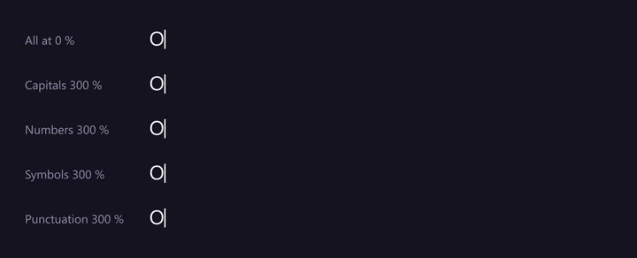
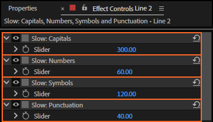
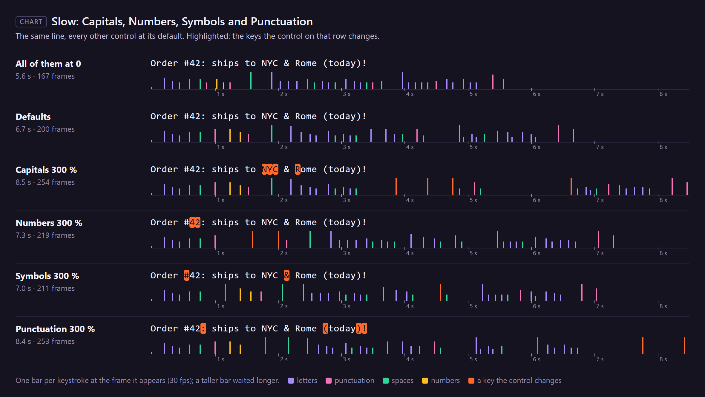

# 16. Slow: Capitals, Numbers, Symbols and Punctuation

Some keys are harder to hit than letters: capitals need Shift, numbers and symbols sit at the top of
the keyboard, punctuation breaks the flow. These four controls make those characters take longer,
each by what the character **is**.

*Rendered by After Effects: the top line has all four at 0; each line below raises one of them to
300 % (the other three at their defaults).*

## Where to find them

## How much slower

Every Slow: control works the same way: at **v %** the character takes **1 + v/100** times as long
as it otherwise would. 100 % is twice as long, 300 % four times, 0 % changes nothing. Values below 0
act as 0 (to make keys faster, use the Fast: controls, chapter 19). A character that two controls
slow is slowed by both, one after the other.

## Which characters

| Control | Slows | Default |
|---|---|---|
| **Slow: Capitals** | upper-case letters, in any script that has upper and lower case (Latin, Greek, Cyrillic…) | 60 |
| **Slow: Numbers** | the digits 0 to 9 | 60 |
| **Slow: Symbols** | `@ # $ % ^ & * _ + = < > { } \| \ / ~` and the backtick | 120 |
| **Slow: Punctuation** | `. , ; : ! ? ' " - ( ) [ ]`, `… — – ‘ ’ “ ” ¿ ¡`, the Bengali and Hindi `। ॥`, the Arabic `، ؟` and the Japanese and Chinese `、 。` | 40 |

The first character of a run appears at once and is never slowed, so the "O" of "Order" below is not.

For "Order #42: ships to NYC & Rome (today)!" (39 characters, 30 fps):

| | The take |
|---|---|
| all four at 0 | 167 frames |
| defaults (60, 60, 120, 40) | 200 frames |
| Capitals 300 % | 254 frames |
| Numbers 300 % | 219 frames |
| Symbols 300 % | 211 frames |
| Punctuation 300 % | 253 frames |

## Step by step

1. Select the rigged text layer; its controls are in Effect Controls.
2. Set the control: drag the value or click it and type.
3. Play. To compare, the panel's rhythm strip (chapter 5) shows a preset's rhythm before you apply it.

## Tips and pitfalls

- **Text in capitals** ("NYC", a shouted line) gets slow everywhere: raise **Fast: Capitals in a
  Row** (chapter 19) so only the first capital of each run waits, or lower Slow: Capitals for an
  all-caps title. **Fast: Numbers in a Row** does the same for "2026".
- **Code and handles** are full of symbols: lower Slow: Symbols, or they crawl.
- **Punctuation and the pause after it are separate**: this control slows the comma itself; the
  breath after it is Slow: After Punctuation (chapter 17).
- **Scripts without capitals** (Bengali, Japanese…) are never slowed by Slow: Capitals.

## Related

- [17. Slow: After Punctuation, Sentence End, Last Character and line breaks](17-slow-after.md)
- [18. Slow: Word Start, Long Words, Rare Letters and Same Finger](18-slow-words.md)
- [19. Fast: Repeated Letters, Capitals and Numbers in a Row, Common Pairs, Common Words and Word Momentum](19-fast.md): Capitals in a Row and Numbers in a Row
- [5. Typing presets](05-typing-presets.md): what each preset sets them to.
