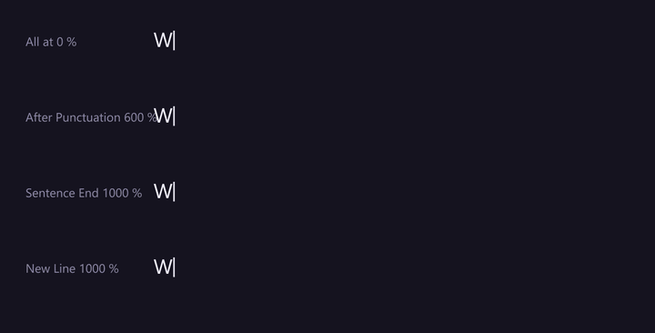
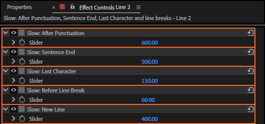
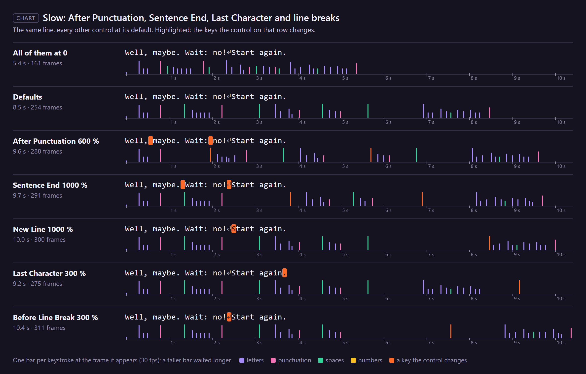

# 17. Slow: After Punctuation, Sentence End, Last Character and line breaks

People stop after a comma, longer after a full stop, take a moment before and after pressing Return,
and land the last key of a line with a beat. These controls slow the characters around such places.

*Rendered by After Effects: the top line has all three at 0; each line below raises one (After
Punctuation 600 %, Sentence End 1000 %, New Line 1000 %), the others at their defaults.*

## Where to find them

In Effect Controls they come in this order: Slow: After Punctuation, Slow: Sentence End,
**Slow: Last Character**, **Slow: Before Line Break**, Slow: New Line. **Slow/Fast: Empty Lines**
sits with the other Slow/Fast controls, after Slow/Fast: Spaces.

## Which characters

| Control | Slows | Default |
|---|---|---|
| **Slow: After Punctuation** | the character after `, ; :` and the Arabic `،` and Japanese `、` | 250 |
| **Slow: Sentence End** | the character after `. ! ?` and `। ॥ ؟ 。` | 500 |
| **Slow: Last Character** | the last character of the text; spaces and line breaks after it don't count | 0 (Average: 150) |
| **Slow: Before Line Break** | a line break itself: the wait before Return is pressed (only the first of several in a row) | 0 (Average: 60) |
| **Slow: New Line** | the character after a line break (Return in the text) | 400 |
| **Slow/Fast: Empty Lines** | each line break after the first in a row (an empty line), on top of New Line: above 0 slower, below 0 faster | 0 (Average: −50) |

At **v %** that character takes **1 + v/100** times as long: the default 500 % makes the key after a
full stop take six times as long, a clear breath between sentences. Empty Lines below 0 divides
instead: −50 % is one and a half times as fast (chapter 20).

The defaults are what a new control starts at; the presets set the newer ones (Last Character,
Before Line Break, Empty Lines) to the values in brackets, so a rig made with *Average* has them. A
rig made with LazyTyper 1.2.0 or earlier gets them at 0 when you click **Refresh**, so its timing
stays as it was.

Things worth knowing:

- After Punctuation, Sentence End and New Line slow the **next character**, whatever it is: usually
  the space after the full stop.
- When a line break comes right after "!", the line break is the character after the sentence end
  (it waits for Sentence End, and for Before Line Break too) and the first letter of the new line
  waits for New Line.
- **"..."** counts each dot as a sentence end: the second and third dots wait, and so does the
  character after them.

## The last character

**Slow: Last Character** waits before the text's last key: the closing "." or "!" comes a beat after
the word, the way someone finishing a message does. Trailing spaces and line breaks are skipped, so
in "Done!" followed by a Return it is still the "!" that waits. It only looks at the text as it is
at that moment: after Erase and a new Source Text, it is the new text's last character.

## A line break in three stages

For the text "no!", a Return and "Start", the cursor:

1. waits at the end of "no!" (**Before Line Break**; here Sentence End as well),
2. jumps to the next line when Return is pressed and waits there (**New Line**, on the "S"),
3. types on.

With an empty line in between (two Returns), the second Return waits for New Line too (it comes
after a line break), and **Empty Lines** makes that extra wait longer or shorter: pressing Return
twice is quick for most people, so the presets set it below 0.

For "Well, maybe. Wait: no!", a line break, "Start again." (35 characters with the line break):

| | The take |
|---|---|
| After Punctuation, Sentence End and New Line at 0 | 161 frames |
| defaults (250, 500, 400; the newer ones 0) | 254 frames |
| After Punctuation 600 % | 288 frames |
| Sentence End 1000 % | 291 frames |
| New Line 1000 % | 300 frames |
| Last Character 300 % | 275 frames |
| Before Line Break 300 % | 311 frames |

With an empty line (two line breaks, 36 characters), the defaults take 270 frames; Empty Lines at
200 % makes it 302, at −50 % 264.

## Step by step

1. Select the rigged text layer.
2. Set the control in Effect Controls.
3. Play.

## Tips and pitfalls

- **Pauses you place by hand** come on top of these waits only in part: the first key after a Pause
  marker appears at once (chapter 7). If you place a pause after every sentence, lower Sentence End.
- **Lists and code** ("a, b, c" or `f(a, b)`) wait after every comma: lower After Punctuation.
- **A paragraph that wraps by itself** has no line breaks: Before Line Break, New Line and Empty
  Lines only apply where the text has a Return.
- **Before Line Break after a full stop** adds to Sentence End: the break waits for both. Keep it low
  in texts where every line ends a sentence.
- **Last Character on a one-character text** does nothing: the first key of a run appears at once.

## Related

- [16. Slow: Capitals, Numbers, Symbols and Punctuation](16-slow-characters.md)
- [20. Slow/Fast: Spaces, Same Hand and Fatigue](20-slow-fast.md): how values below 0 work
- [7. Pauses](07-pauses.md)
