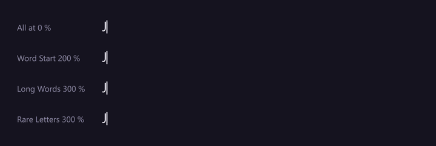
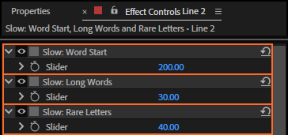
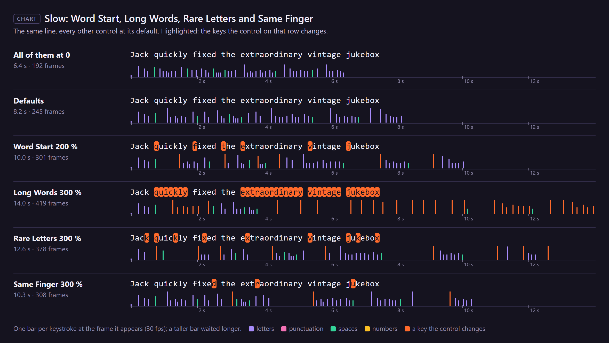

# 18. Slow: Word Start, Long Words, Rare Letters and Same Finger

A typist hesitates at the start of each word, slows down through long ones, hunts for the keys they
seldom use, and loses a moment when one finger has to type two keys in a row. These controls slow
characters by their place in a word, by being rare, or by the finger that types them.

*Rendered by After Effects: the top line has all three at 0; each line below raises one (Word Start
200 %, Long Words 300 %, Rare Letters 300 %), the others at their defaults.*

## Where to find them

**Slow: Same Finger** comes right after Slow: Rare Letters.

## Which characters

A **word** here is a run of letters and digits; spaces and punctuation end it.

| Control | Slows | Default |
|---|---|---|
| **Slow: Word Start** | the first letter or digit of every word | 50 |
| **Slow: Long Words** | every letter of a word longer than 6 characters, more for longer words: a 7-character word gets 1/6 of the value, 9 characters half, 12 or more all of it | 30 |
| **Slow: Rare Letters** | q, z, x, j, k and v, in either case | 40 |
| **Slow: Same Finger** | a letter typed by the same finger as the letter before it, on a different key (the same key twice is Repeated Letters, chapter 19) | 0 (Average: 20) |

At **v %** a character takes **1 + v/100** times as long (for Long Words, v times the share above).
The first character of a run appears at once and is never slowed.

### Which finger

Same Finger follows QWERTY touch typing, each finger on its own column of keys:

| Left little | Left ring | Left middle | Left index | Right index | Right middle | Right ring | Right little |
|---|---|---|---|---|---|---|---|
| q a z | w s x | e d c | r f v t g b | y h n u j m | i k | o l | p |

So "ed", "ce", "un", "my", "tr", "ol" and "ki" are typed by one finger, and so are "fr", "gr" and
"br"; "th" and "in" are not. Capitals count as their small letter; digits, punctuation and letters
outside a–z never count, and a space between two letters breaks the pair. Very fast typists feel this
most: the Very Fast preset sets 40, Average 20, Hunt & Peck 0 (two fingers hunt for every key anyway).
It adds to **Slow/Fast: Same Hand** (chapter 20), since the same finger is always the same hand.

A rig made with LazyTyper 1.2.0 or earlier gets Same Finger at 0 when you click **Refresh**, so its
timing stays as it was.

For "Jack quickly fixed the extraordinary vintage jukebox" (52 characters):

| | The take |
|---|---|
| all three at 0 | 192 frames |
| defaults (50, 30, 40) | 245 frames |
| Word Start 200 % | 301 frames |
| Long Words 300 % | 419 frames |
| Rare Letters 300 % | 378 frames |
| Same Finger 300 % ("ed" in fixed, "tr" in extraordinary, "ju" in jukebox) | 308 frames |

## Step by step

1. Select the rigged text layer.
2. Set the control in Effect Controls.
3. Play.

## Tips and pitfalls

- **Word Start and Common Words work against each other** on short common words ("the", "and"):
  the first letter is slowed, the whole word sped up (chapter 19).
- **Technical text** (long words, x, z, k) gets slow fast: lower Long Words and Rare Letters for
  product names and code.
- **Rare Letters is about English keyboards**; letters with accents are not counted as rare.
- **Same Finger assumes QWERTY** and the touch-typing fingers above; on other layouts or scripts it
  does nothing useful.

## Related

- [19. Fast: Repeated Letters, Capitals and Numbers in a Row, Common Pairs, Common Words and Word Momentum](19-fast.md)
- [20. Slow/Fast: Spaces, Same Hand and Fatigue](20-slow-fast.md)
- [16. Slow: Capitals, Numbers, Symbols and Punctuation](16-slow-characters.md)
