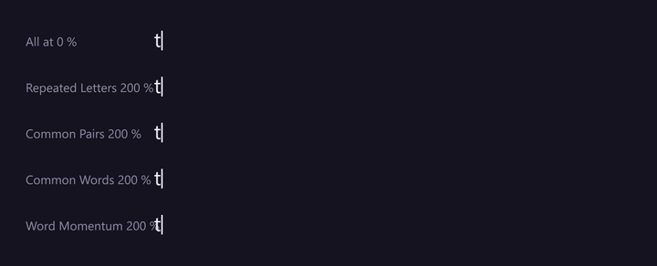
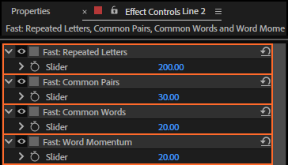

# 19. Fast: Repeated Letters, Capitals and Numbers in a Row, Common Pairs, Common Words and Word Momentum

Fingers fly through what they type every day: a double letter, "th", "the", the end of a word once
it has started, the rest of "NASA" once Shift is down. These controls make those characters
**faster**; Repeated Letters can also make a double letter slower.

*Rendered by After Effects: the top line has all four at 0; each line below raises one to 200 %, the
others at their defaults.*

## Where to find them

**Fast: Capitals in a Row** and **Fast: Numbers in a Row** come right after Fast: Repeated Letters.

## How much faster

At **v %** the character takes its time **divided by 1 + v/100**: 100 % is twice as fast, 200 %
three times. Values below 0 act as 0, except for Repeated Letters (below) and the two "in a Row"
controls, which work as a share of a slow-down (further down).

## Which characters

| Control | Speeds up | Default |
|---|---|---|
| **Fast: Repeated Letters** | a letter that is the same as the one before it (ignoring case): the second "m" and "t" in "committee". **Below 0 it slows them down** instead | 30 |
| **Fast: Capitals in a Row** | capitals after the first in a row: the "ASA" of "NASA" (see below) | 0 (Average: 50) |
| **Fast: Numbers in a Row** | digits after the first in a row: the "026" of "2026" | 0 (Average: 40) |
| **Fast: Common Pairs** | a letter that makes one of 42 common English pairs with the letter before: th he in er an re on at en nd ti es or te of ed is it al ar st to nt ng se ha as ou io le ve co me de hi ri ro ic ne ea ra ce | 30 |
| **Fast: Common Words** | every character of one of 40 common English words: the and to of a in is it you that for on with as was i be at this have are he she we they but not or my your so if do can will just all an by from | 20 |
| **Fast: Word Momentum** | letters from the third of a word on, more the further in: the third letter gets a quarter of the value, the fourth half, the fifth three quarters, the sixth and later all of it | 20 |

The first character of a run appears at once and is never sped up.

### Repeated Letters both ways

Above 0 a double letter is faster: the finger is already on the key, which is how someone typing
with two fingers works (Hunt & Peck sets 60). **Below 0 it is slower**: at −v % the letter takes
**1 + v/100** times as long, like a Slow: control. Fast typists stumble on a double key, so the Very
Fast preset sets −25; Average sets 15.

A rig or saved preset from LazyTyper 1.2.0 or earlier with Repeated Letters below 0 typed as if it
were 0 (1.2.0 ignored such values). When Refresh brings the rig up to date, or the panel the preset,
the value becomes 0, so it keeps typing the same.

### Capitals and Numbers in a Row

Typing "NASA" means finding Shift once and holding it; "2026" means reaching the number row once.
So the first capital or digit is the slow one. These two controls work **with Slow: Capitals and
Slow: Numbers** (chapter 16): the first in a row keeps all of that slow-down, and every one after it
loses this share of it.

| Fast: Capitals in a Row | With Slow: Capitals at 100 %, "NASA" waits |
|---|---|
| 0 % (as before) | N, A, S, A twice as long each |
| 50 % | N twice as long; A, S, A one and a half times |
| 100 % | N twice as long; A, S, A like small letters |

Values above 100 act as 100: a capital in a row is never faster than a small letter because of
this control. With Slow: Capitals at 0 there is nothing to take away. A capital after a small letter
("NaSA": the S) is the first of a new row. Digits work the same way with Slow: Numbers; a capital
next to a digit does not make a row.

A rig made with LazyTyper 1.2.0 or earlier gets both at 0 when you click **Refresh**, so every
capital and digit keeps its full slow-down, as before.

For "the committee will meet in the coffee shop at noon" (50 characters):

| | The take |
|---|---|
| all four at 0 | 236 frames |
| defaults (30, 30, 20, 20) | 198 frames |
| Repeated Letters 200 % | 185 frames |
| Common Pairs 200 % | 177 frames |
| Common Words 200 % | 173 frames |
| Word Momentum 200 % | 168 frames |
| Repeated Letters −50 % / −100 % | 221 / 237 frames |

For "NASA and ESA booked 2026 seats for $1500" (40 characters):

| | The take |
|---|---|
| defaults (Capitals in a Row and Numbers in a Row at 0) | 205 frames |
| Capitals in a Row 50 % / 100 % | 198 / 191 frames |
| Numbers in a Row 100 % | 189 frames |
| both 100 % | 175 frames |

## Step by step

1. Select the rigged text layer.
2. Set the control in Effect Controls.
3. Play.

## Tips and pitfalls

- **These lists are English.** Other languages get Repeated Letters and Word Momentum, which work in
  any script; Common Pairs and Common Words only match English.
- **An all-caps title**: raise Capitals in a Row rather than lowering Slow: Capitals, so each word's
  first capital still waits.
- **Repeated Letters below 0 and Same Finger** (chapter 18) are both a fast typist's stumbles: use
  them together for a typist who is quick but not a machine.
- **A very fast typist** has more of all four; Hunt & Peck has almost none (chapter 5).
- **Word Momentum and Long Words** pull in opposite directions in long words: one speeds the letters
  up as the word goes on, the other slows the whole word down (chapter 18).

## Related

- [16. Slow: Capitals, Numbers, Symbols and Punctuation](16-slow-characters.md): the slow-downs the
  "in a Row" controls take a share of
- [18. Slow: Word Start, Long Words, Rare Letters and Same Finger](18-slow-words.md)
- [20. Slow/Fast: Spaces, Same Hand and Fatigue](20-slow-fast.md)
