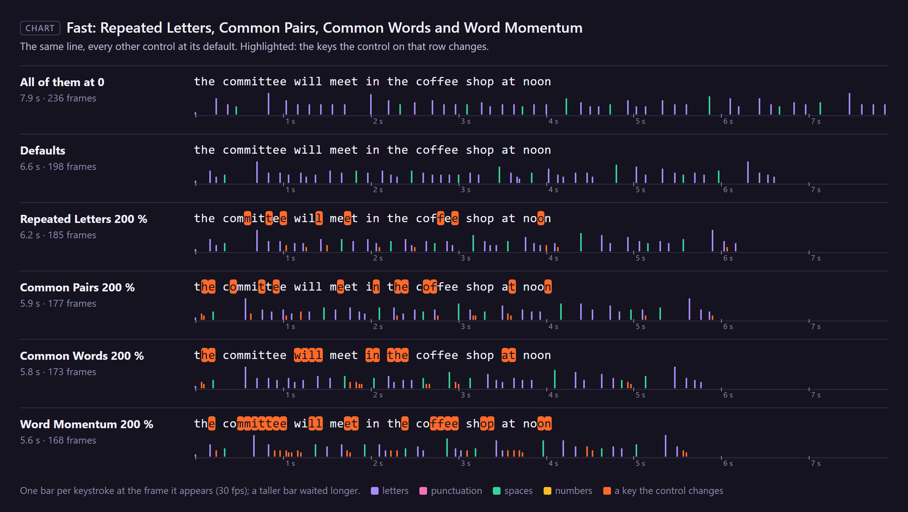

# 19. Fast: Repeated Letters, Common Pairs, Common Words and Word Momentum

Fingers fly through what they type every day: a double letter, "th", "the", the end of a word once
it has started. These four controls make those characters **faster**.

*Rendered by After Effects: the top line has all four at 0; each line below raises one to 200 %, the
others at their defaults.*

## Where to find them

## How much faster

At **v %** the character takes its time **divided by 1 + v/100**: 100 % is twice as fast, 200 %
three times. Values below 0 act as 0.

## Which characters

| Control | Speeds up | Default |
|---|---|---|
| **Fast: Repeated Letters** | a letter that is the same as the one before it (ignoring case): the second "m" and "t" in "committee" | 30 |
| **Fast: Common Pairs** | a letter that makes one of 42 common English pairs with the letter before: th he in er an re on at en nd ti es or te of ed is it al ar st to nt ng se ha as ou io le ve co me de hi ri ro ic ne ea ra ce | 30 |
| **Fast: Common Words** | every character of one of 40 common English words: the and to of a in is it you that for on with as was i be at this have are he she we they but not or my your so if do can will just all an by from | 20 |
| **Fast: Word Momentum** | letters from the third of a word on, more the further in: the third letter gets a quarter of the value, the fourth half, the fifth three quarters, the sixth and later all of it | 20 |

The first character of a run appears at once and is never sped up.

For "the committee will meet in the coffee shop at noon" (50 characters):

| | The take |
|---|---|
| all four at 0 | 236 frames |
| defaults (30, 30, 20, 20) | 198 frames |
| Repeated Letters 200 % | 185 frames |
| Common Pairs 200 % | 177 frames |
| Common Words 200 % | 173 frames |
| Word Momentum 200 % | 168 frames |

## Step by step

1. Select the rigged text layer.
2. Set the control in Effect Controls.
3. Play.

## Tips and pitfalls

- **These lists are English.** Other languages get Repeated Letters and Word Momentum, which work in
  any script; Common Pairs and Common Words only match English.
- **A very fast typist** has more of all four; Hunt & Peck has almost none (chapter 5).
- **Word Momentum and Long Words** pull in opposite directions in long words: one speeds the letters
  up as the word goes on, the other slows the whole word down (chapter 18).

## Related

- [18. Slow: Word Start, Long Words and Rare Letters](18-slow-words.md)
- [20. Slow/Fast: Spaces, Same Hand and Fatigue](20-slow-fast.md)
