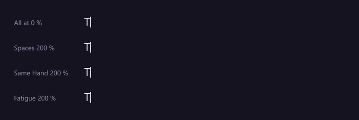
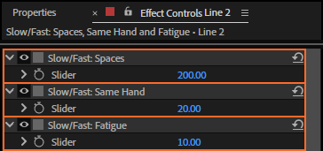
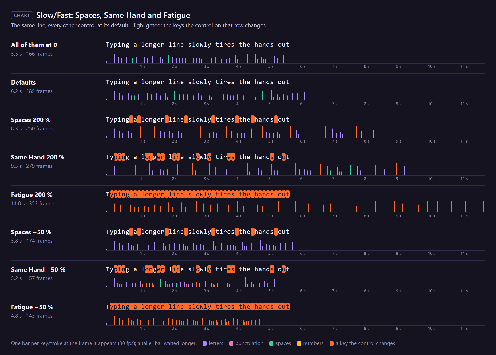

# 20. Slow/Fast: Spaces, Same Hand and Fatigue

Three controls that go either way: **above 0 they slow down, below 0 they speed up**. A typist may
pause at every space or fly over them, stumble when one hand types two letters in a row or not, tire
as the text goes on or warm up.

*Rendered by After Effects: the top line has all three at 0; each line below raises one to 200 %,
the others at their defaults.*

## Where to find them

## How much

At **+v %** a character takes **1 + v/100** times as long (as the Slow: controls); at **−v %** its
time is **divided by 1 + v/100** (as the Fast: controls). So +100 % is twice as long and −50 %
one and a half times as fast.

## Which characters

| Control | Applies to | Default |
|---|---|---|
| **Slow/Fast: Spaces** | spaces, tabs, no-break spaces, thin spaces and the ideographic space | 0 |
| **Slow/Fast: Same Hand** | a letter typed by the same hand as the letter before it, on a QWERTY keyboard: left hand `q w e r t a s d f g z x c v b`, right hand `y u i o p h j k l n m` (other characters never count) | 20 |
| **Slow/Fast: Fatigue** | every character, more towards the end: none on the first, the whole value on the last, in proportion in between | 10 |

For "Typing a longer line slowly tires the hands out" (47 characters):

| | The take |
|---|---|
| all three at 0 | 166 frames |
| defaults (0, 20, 10) | 185 frames |
| Spaces 200 % / −50 % | 250 / 174 frames |
| Same Hand 200 % / −50 % | 279 / 157 frames |
| Fatigue 200 % / −50 % | 353 / 143 frames |

## Step by step

1. Select the rigged text layer.
2. Set the control in Effect Controls, above or below 0.
3. Play.

## Tips and pitfalls

- **Negative Spaces** makes a fluent typist (Very Fast uses −20, Hunt & Peck −30: someone who
  types word by word and hits the space bar quickly).
- **Negative Fatigue** is a typist who gets into the flow: the end of a long text comes faster.
- **Fatigue counts the whole text**, not the line: in a long paragraph the last line is the most
  tired one. It counts from the first character of the text, even when Start at Character skips some.
- **Same Hand assumes QWERTY** and Latin letters; on other layouts or scripts it does nothing useful.

## Related

- [19. Fast: Repeated Letters, Common Pairs, Common Words and Word Momentum](19-fast.md)
- [16. Slow: Capitals, Numbers, Symbols and Punctuation](16-slow-characters.md)
- [5. Typing presets](05-typing-presets.md)
