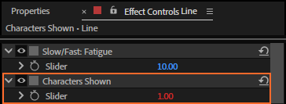

# 21. Characters Shown

**Characters Shown**, the last control on a rigged text layer, is the rig's result: how many
characters of the text show at this frame. Read it to drive anything else from the typing: a
counter, a sound, a progress bar, a layer that waits for the last word.


## Where to find it

At the bottom of the text layer's Effect Controls:



## What it holds

| Rig | Characters Shown |
|---|---|
| Stable | runs the typing engine itself (its expression), and the rig's animator hides everything from that count on |
| Dynamic | reads back how long the typed text in Source Text is (the engine runs in Source Text) |
| Baked | hold keyframes, one per keystroke (chapter 10) |

Don't type a value into it or change its expression: the rig sets it. Change the typing with the
other controls instead.

## Reading it from another layer

The counter above is a second text layer whose Source Text has this expression:

```
var n = Math.round(thisComp.layer("Line").effect("Characters Shown")(1).value);
"Characters Shown: " + n
```

Pick-whip *Characters Shown* from any property's expression to get the first line. Some ideas:

- **A progress bar**: a shape's Scale X as `n / total * 100`.
- **Something that starts when the typing ends**: compare `n` with the text's length,
  `thisComp.layer("Line").text.sourceText.value.length`, on a Stable rig (on a Dynamic rig Source
  Text already shows only the typed part).
- **A keystroke sound**: bake the rig (chapter 10); the keyframes are the keystrokes, so you can
  place sounds on them.

## Tips and pitfalls

- **Round it**: the value is a whole number in practice, but `Math.round` keeps comparisons safe.
- **A rig's own cursor reads it too**: that is how the cursor knows when keys are coming in
  (chapter 24).
- **Bake makes reading it free**: an expression reading a baked rig reads keyframes, not the engine.

## Related

- [3. How a rig works](03-how-a-rig-works.md)
- [10. Bake and Unbake](10-bake.md)
- [13. Typing and Start at Character](13-typing-start-at-character.md)
