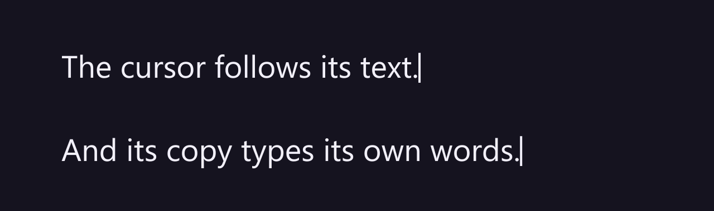

# 22. How the cursor finds its rig

A cursor follows its own text layer through **parenting**: a Stable rig's cursor is parented to its
text, a Dynamic rig's cursor to the hidden guide, which is parented to the text. Nothing else links
them. That is also why a whole rig can be copied: After Effects carries parenting over to the copies,
so the copied cursor follows the copied text.

## Where to see it

The **Parent & Link** column of the Timeline shows the links. Here a Dynamic rig: *Line Cursor* is
parented to *Line Guide*, and the guide to *Line*:

Because the guide's position, scale and rotation are those of the text, the cursor moves, scales and
turns with the text either way.

## Copy a whole rig

To make a second line that types like the first, copy the whole rig: its text, its cursor and, for a
Dynamic rig, its guide.

1. In the Timeline, select the three layers: they sit one under another, so click the cursor and
   Shift+click the guide. The guide is *shy*: if the comp's **Hide Shy Layers** switch is on, switch
   it off first to see it.
2. **Edit › Duplicate** (Ctrl+D, Cmd+D on macOS), or **Edit › Copy** and **Edit › Paste** in this
   comp or another one.
3. Move the copy and change its text: it types on its own, and its cursor follows it.

The panel sees the copy as a rig of its own: select it and the status line names it, with its own
cursor. Nothing needs a Refresh, unless you change a Stable copy's text (chapter 9).

## What reads the links

- The cursor's **position** reads the guide (Dynamic) or a table of points measured on its text
  (Stable), and its **shape**, **colour** and **blink** read the text layer's *Characters Shown*.
- The panel finds a rig's cursor by its comment, *LazyTyper cursor*, and its parenting; the guide by
  its comment, *LazyTyper guide*, and its parent.

## Rigs made before LazyTyper 1.3

Their cursors also had two controls at the top of Effect Controls, **Text Layer** and **Guide
Layer**, which their expressions read. A copy of such a rig kept pointing at the original layers, so
its cursor stayed on the original line. They keep working as they are; select a rig and click
**Refresh** once (chapter 9): it takes the two controls off, puts a Dynamic cursor under its guide and
leaves everything else as it was. Copy it after that.

## Tips and pitfalls

- **Don't re-parent the cursor or the guide**: the cursor's expressions find the text through them.
- **Copy all of a Dynamic rig.** A copied cursor without its guide stays under the original guide and
  follows the original line (it sits exactly on the original cursor). Delete that copy, select the
  copied text and click **Add cursor** (chapter 12), which gives it a guide and a cursor of its own.
- **Duplicating only the text layer** gives a copy that types but has no cursor: select the copy and
  click **Add cursor**.
- **Moving layers in the stack** is fine: parenting follows the layer, not its number.
- **Leave the guide as it is**: it is switched off, a guide layer and shy on purpose. Switching it on
  shows a second copy of the text in the Comp panel (guide layers are left out of renders).

## Related

- [3. How a rig works](03-how-a-rig-works.md)
- [9. Refresh](09-refresh.md)
- [12. Cursor presets](12-cursor-presets.md): Add cursor.
