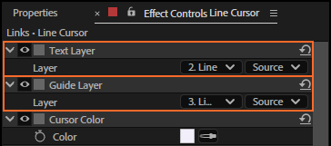
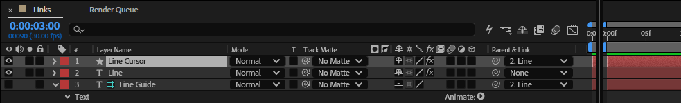

# 22. Text Layer and Guide Layer

The first controls on a cursor layer link it to its rig: **Text Layer** is the text it follows, and,
for a Dynamic rig, **Guide Layer** is the hidden guide that measures where the last typed character
ends. The rig sets both; they are there so you can see the link, and so the panel finds the cursor
that belongs to a text layer.

## Where to find them

Select the cursor layer (*‹text› Cursor*); its controls are in Effect Controls:

The cursor is also **parented** to its text layer, so it moves, scales and turns with it:

## What reads them

- The cursor's **position** reads the guide (Dynamic) or a table of points measured on the text
  (Stable), and its **blink** reads the text layer's *Characters Shown*.
- The panel finds a rig's cursor by its comment, *LazyTyper cursor*, and its Text Layer link; the
  guide by its comment, *LazyTyper guide*, and its parent.

## Tips and pitfalls

- **Don't point a cursor at another text layer**: its shape and position are measured for its own
  text. Add a cursor to the other rig instead (chapter 12).
- **Moving layers in the stack** is fine: layer links follow the layer, not its number.
- **Duplicating a rigged text layer** gives a copy that types, but the cursor still belongs to the
  original: select the copy and click Add cursor (chapter 12) to give it its own.
- **Leave the guide as it is**: it is switched off, a guide layer and shy on purpose. Switching it on
  shows a second copy of the text in the Comp panel (guide layers are left out of renders).

## Related

- [3. How a rig works](03-how-a-rig-works.md)
- [12. Cursor presets](12-cursor-presets.md): Add cursor.
