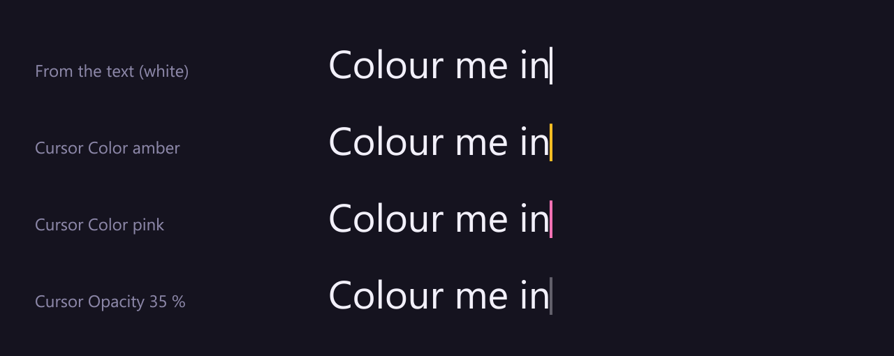
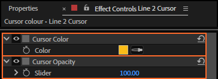

# 23. Cursor Color and Cursor Opacity

**Cursor Color** is the cursor's fill; **Cursor Opacity** how solid it is when it shows.

## Where to find them

On the cursor layer, after the links:

## Step by step

1. Select the cursor layer.
2. Click the colour swatch (or use the eyedropper) and choose a colour.
3. Set Cursor Opacity, in %.

## Every setting

| Control | Values | Default |
|---|---|---|
| **Cursor Color** | any colour | the text's fill colour when the rig was made (white if the text has no fill) |
| **Cursor Opacity** | 0 to 100 % | 100 |

The colour is set once, when the cursor is made: changing the text's colour later does not change
the cursor's. Blink (chapter 24) works on top of Cursor Opacity: a blinking cursor at 35 % goes
between 35 % and nothing.

## Tips and pitfalls

- **Cursor presets leave the colour alone** (chapter 12): Apply changes the shape and blink only.
- **Keyframe the colour** for a cursor that changes with the mood; both controls can be keyframed.
- **A cursor that should not show** at all: Cursor Opacity 0, or no cursor at Create.

## Related

- [24. Blink](24-cursor-blink.md)
- [12. Cursor presets](12-cursor-presets.md)
