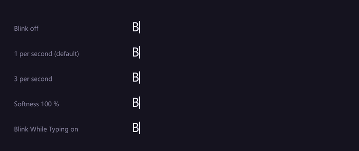
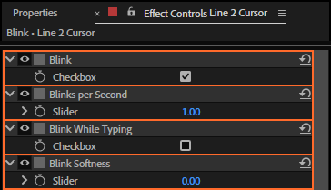

# 24. Blink, Blinks per Second, Blink While Typing and Blink Softness

A cursor blinks when nothing is being typed and stays solid while keys come in. These four controls
set whether it blinks, how fast, whether it also blinks while typing, and how soft each blink is.

*Rendered by After Effects at 30 fps, 4.5 s.*

## Where to find them

## What each does

| Control | Values | Default | What it does |
|---|---|---|---|
| **Blink** | on, off | on | Off: the cursor is solid all the time. |
| **Blinks per Second** | any number above 0 | 1 | How many times a second it blinks: on for the first half of each blink, off for the second. |
| **Blink While Typing** | on, off | off | Off: the cursor stays solid while characters are changing, and for 0.4 s after the last change. On: it blinks through the typing too. |
| **Blink Softness** | 0 to 100 % | 0 | 0: a hard on and off. 100: a smooth fade in and out. Between: a mix of the two. |

The blink follows the comp's time, starting on at 0 s, so two cursors with the same rate blink
together. Cursor Opacity sets how solid "on" is (chapter 23).

## Step by step

1. Select the cursor layer.
2. Set the controls in Effect Controls.
3. Play: the blink shows only in the playback or a render, not in a still frame chosen at random.

## Tips and pitfalls

- **A cursor that keeps flashing while text types** looks busy: keep Blink While Typing off (the
  default), the way real cursors behave.
- **Erasing counts as typing**: the cursor is solid while characters go too (chapter 8).
- **Very slow typing** (Hunt & Peck) can leave more than 0.4 s between keys: the cursor then blinks
  between keystrokes, which looks natural.
- **Blink off and Cursor Opacity keyframed** gives you a cursor you fade in and out by hand.

## Related

- [23. Cursor Color and Cursor Opacity](23-cursor-colour.md)
- [21. Characters Shown](21-characters-shown.md): what the blink reads.
