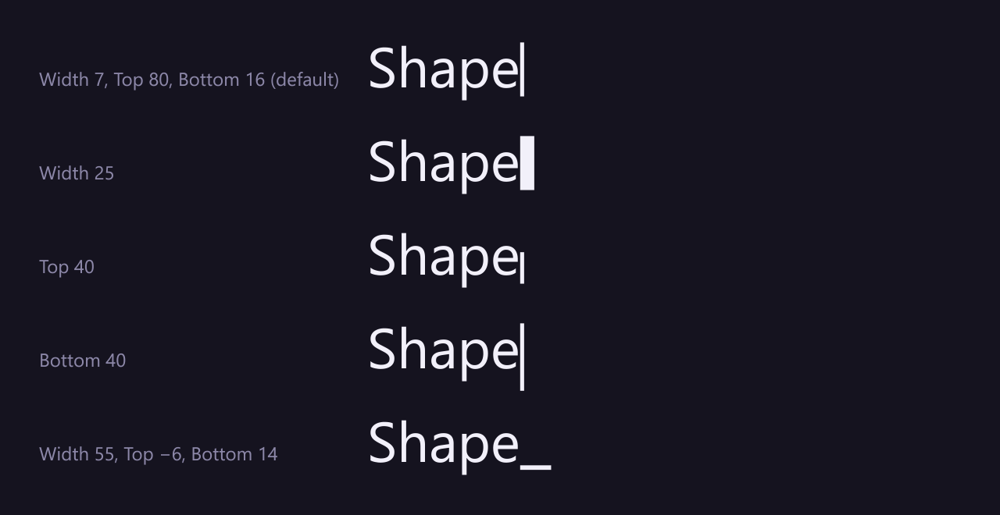
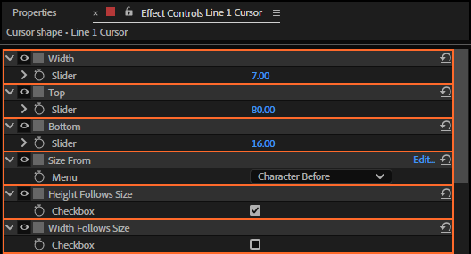
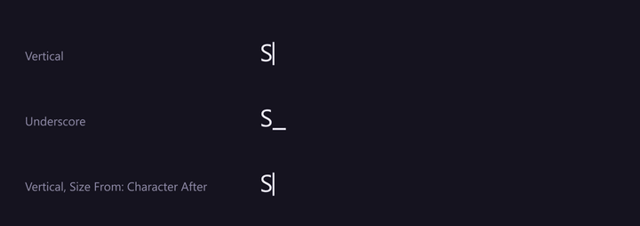

# 25. Width, Top, Bottom and Size From

The cursor is a rectangle that starts right after the last typed character. **Width** sets how wide
it is, **Top** how far it reaches above the baseline, **Bottom** how far below. All three are
percentages of the font size, so the cursor fits whatever size the text is. With mixed font sizes in
a Stable rig, **Size From** chooses which character's size that is, and **Height Follows Size** and
**Width Follows Size** whether the height and width grow and shrink with it.

## Where to find them

## What each does

| Control | Default | What it does |
|---|---|---|
| **Width** | 7 | The width, growing to the right from where the cursor starts. Below 0 acts as 0. |
| **Top** | 80 | How far the top edge is above the baseline. Negative: below the baseline. |
| **Bottom** | 16 | How far the bottom edge is below the baseline. Negative: above it. |
| **Size From** | Character Before | Whose font size the cursor takes: *Character Before*, the last character typed (at the start of a line, the next one), or *Character After*, the next character to be typed (at the end of a line or the text, the last one typed). Can be keyframed. |
| **Height Follows Size** | on | Off: Top and Bottom count in the text's main size (the size most of its characters have), whatever the character beside the cursor. |
| **Width Follows Size** | on (off in the Vertical preset) | The same for Width. |

All in % of the font size: at 72 px, Width 7 is about 5 px and Top 80 about 58 px. If Top and Bottom
cross (the top edge below the bottom edge), they swap.

The **Underscore** preset is Width 55, Top −6, Bottom 14: a flat bar below the baseline, starting
right after the last character. **Box** is Width 55, Top 80, Bottom 18.

## Mixed font sizes

In a **Stable** rig each character keeps its own size, and so does the cursor: beside a big word it
is as big as that word. Size From says which neighbour counts, and the two Follow switches say what
grows:

- **Vertical** (Width Follows Size off): a thin bar that only grows taller; it does not get thicker.
- **Underscore** and **Box** (both on): they grow wider and taller with the word.
- **Size From: Character After**: the cursor takes the next character's size, so it is already big
  where the big word is about to start, and small again on the space after it.

A **Dynamic** rig shows its text in one size, so these three controls change nothing there.

## Step by step

1. Select the cursor layer.
2. Set Width, Top and Bottom in Effect Controls, and for mixed sizes Size From and the two Follow
   switches.
3. Save the shape as a cursor preset if you'll want it again (chapter 12).

## Tips and pitfalls

- **Mixed font sizes** are read from the text's character styles (After Effects 24.3 and later; older
  versions use the text's first style).
- **A cursor that starts too far from the text**: use X Offset (chapter 27), not Width.
- **After changing the font size**, the panel asks for a Refresh: the cursor is measured again
  (chapter 9).
- **Rigs made before LazyTyper 1.3** get Size From (Character Before) and both Follow switches on at
  their next Refresh: they keep growing both ways, as they did.

## Related

- [23. Show Cursor and the colour](23-cursor-colour.md): Use Text Color also takes the colour of the
  character Size From picks.
- [26. Roundness and the corners](26-cursor-corners.md)
- [27. Offset Unit, X Offset and Y Offset](27-cursor-offset.md)
