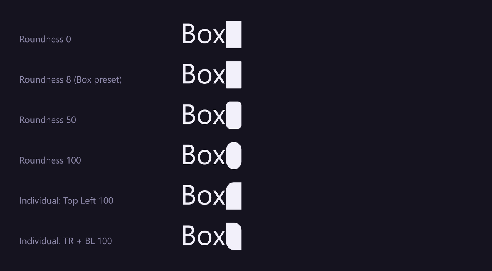
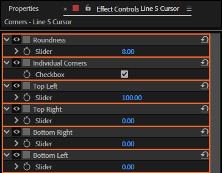

# 26. Roundness, Individual Corners and the four corners

The cursor's corners can be rounded: all four together with **Roundness**, or one by one with
**Individual Corners** and the four corner controls.

## Where to find them

## What each does

| Control | Values | Default | What it does |
|---|---|---|---|
| **Roundness** | 0 to 100 % | 0 (Box: 8) | Rounds all four corners. |
| **Individual Corners** | on, off | off | On: Roundness is ignored and each corner uses its own control. |
| **Top Left, Top Right, Bottom Right, Bottom Left** | 0 to 100 % | 0 (Box: 8) | Each corner's rounding, with Individual Corners on. |

100 % is as round as the cursor can be: a radius of half its shorter side, so a square cursor turns
into a circle and a tall thin one into a pill. Values outside 0 to 100 act as 0 or 100.

## Step by step

1. Select the cursor layer.
2. Set Roundness, or turn on Individual Corners and set the corners.
3. Play.

## Tips and pitfalls

- **A thin Vertical cursor** barely shows roundness: try it on Box or Underscore.
- **A speech-bubble or tab look**: round two opposite corners (the last line in the picture).
- **Cursor presets** store all six controls (chapter 12).

## Related

- [25. Width, Top, Bottom and Size From](25-cursor-shape.md)
- [12. Cursor presets](12-cursor-presets.md)
