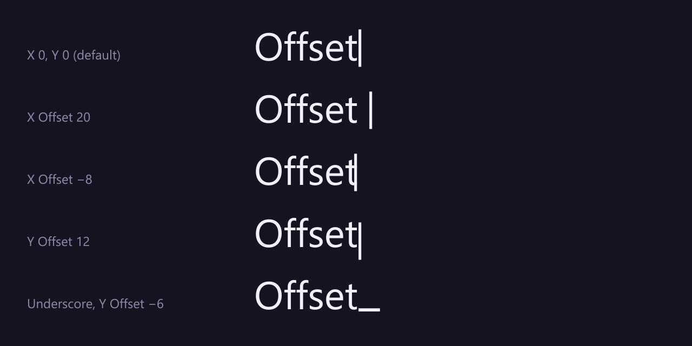
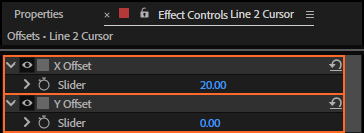

# 27. X Offset and Y Offset

**X Offset** and **Y Offset** move the cursor from where the rig puts it, in pixels of the text
layer: for a little more air after the letters, or an underscore that sits lower.

## Where to find them

## What each does

| Control | Default | What it does |
|---|---|---|
| **X Offset** | 0 | Pixels to the right (negative: to the left). |
| **Y Offset** | 0 | Pixels down (negative: up). |

The rig already leaves a small gap after each character (a little air, so the cursor never touches a
glyph). The offsets are added on top, in the text layer's own pixels: when the text layer is scaled,
the offsets scale with it.

## Tips and pitfalls

- **Offsets are pixels, sizes are percentages**: after a big change of font size, check the offsets.
- **For a cursor that is too tall or too low**, Top and Bottom (chapter 25) are usually the better fix.
- **Offsets are part of cursor presets** (chapter 12).

## Related

- [25. Width, Top and Bottom](25-cursor-shape.md)
- [12. Cursor presets](12-cursor-presets.md)
