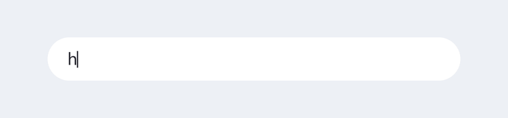
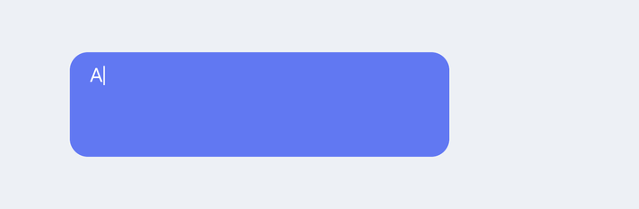
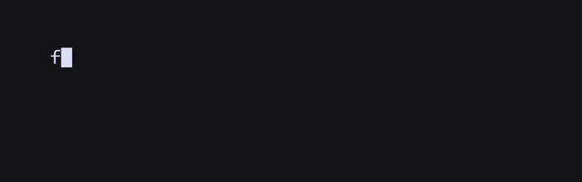
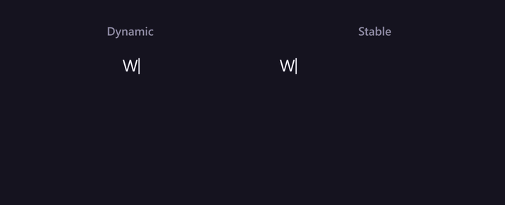
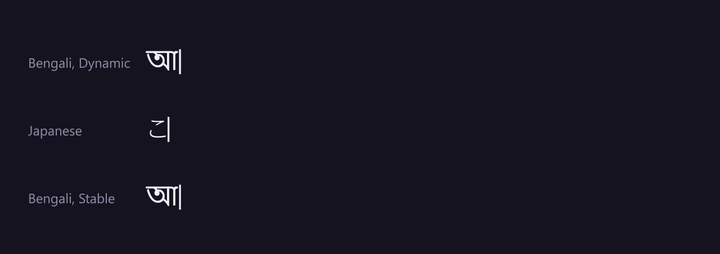
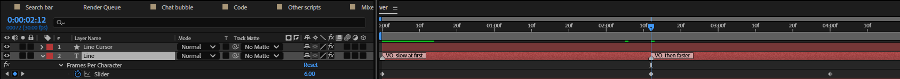
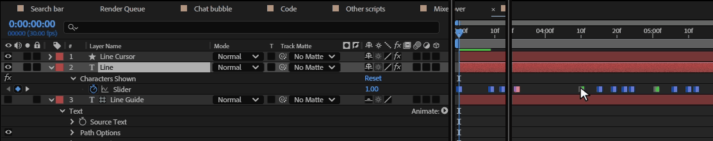
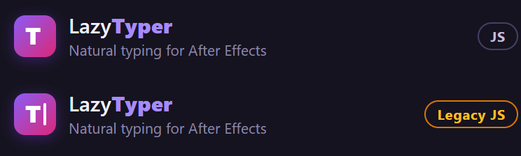

# 28. Recipes

Short walk-throughs for the things LazyTyper is used for most, each built with the panel and
rendered by After Effects.

- [A search bar](#a-search-bar)
- [A chat bubble](#a-chat-bubble)
- [Code](#code)
- [A paragraph that wraps](#a-paragraph-that-wraps)
- [Delete and retype](#delete-and-retype)
- [Bengali, Japanese and other scripts](#bengali-japanese-and-other-scripts)
- [Mixed fonts, sizes and colours](#mixed-fonts-sizes-and-colours)
- [Speed keyed to a voice-over](#speed-keyed-to-a-voice-over)
- [Nudge baked keystrokes](#nudge-baked-keystrokes)
- [Rigs without the panel](#rigs-without-the-panel)
- [The Legacy ExtendScript expression engine](#the-legacy-extendscript-expression-engine)

## A search bar

1. Draw the bar: a rounded rectangle shape layer (here 1040 × 110 px, Roundness 55, white).
2. Type the query as point text, left aligned, in a dark colour, where the bar's text starts.
3. Select the text layer; in Create rig choose **Dynamic**, typing style **Very Fast**, cursor
   **Vertical**; click **Create Typing Rig**.

The cursor takes the text's dark colour by itself. Searches are typed quickly by people who know what
they want, so Very Fast suits them; for someone thinking it over, add a Pause marker (chapter 7).

## A chat bubble

1. Draw the bubble (a rounded rectangle) and make the message **paragraph text**: drag a box with the
   Type tool inside the bubble.
2. Rig it **Dynamic**: words that don't fit move to the next line as they are typed, the way a chat
   app does.

## Code

1. Type the code in a monospaced font (Consolas here), with Returns for the line breaks and spaces
   for the indent.
2. Rig it with the **Box** cursor.
3. Code is full of symbols, brackets and commas: if it crawls, lower **Slow: Symbols** (chapter 16)
   and **Slow: After Punctuation** (chapter 17). Each new line waits for **Slow: New Line**.

## A paragraph that wraps

Use paragraph (box) text and a **Dynamic** rig: it wraps word by word and keeps centred or
right-aligned lines centred as they grow. A Stable rig keeps the finished layout instead. Both are
compared in [chapter 3](03-how-a-rig-works.md):

## Delete and retype

*Stop typing*, *Erase*, a new Source Text keyframe, *Start typing*: [chapter 8](08-erase.md) shows
both ways, a whole line replaced and a typo fixed:

## Bengali, Japanese and other scripts

The engine types any script character by character. Letters of scripts without upper and lower case
count as letters (Slow: Capitals never applies), the Bengali `।` and the Japanese `。` end a
sentence, `、` is a comma, and the English-only controls (Common Pairs, Common Words, Same Hand, Rare
Letters) simply don't match. Choose a font that has the script (Nirmala UI for Bengali and Yu Gothic
for Japanese, here).

**The cursor and Bengali.** Bengali letters join: a consonant with its vowel sign (`মি`), a
conjunct (`ক্ষ`) or a reph (`র্ম`) is one shape, and After Effects counts it as one unit. LazyTyper
1.1.1 counted characters instead, so in a **Dynamic** rig the cursor stayed at the start of the line
(the top line above) and in a **Stable** rig it trailed the text by about a word (the bottom line).
Newer versions count units like After Effects does: the cursor sits after the last letter in both
rigs, and a Stable rig shows a joined letter whole as soon as its first character is typed. The
same goes for Devanagari and the other Indian scripts. A rig made with 1.1.1 or earlier on such text
says "Made by an earlier LazyTyper" in the panel: click **Refresh** once. Japanese, which does not
join its characters, was always right.

## Mixed fonts, sizes and colours

1. Style parts of the text: select characters with the Type tool and change their font, size or
   colour in the Character panel.
2. Rig it **Stable**: it keeps every character's style. (A Dynamic rig rebuilds the text as it types
   and keeps only the first style.)
3. After changing the text or its styles later, click **Refresh** (chapter 9).

## Speed keyed to a voice-over

Every control can be keyframed, so the speed can follow a voice:

1. Put layer markers on the text layer where the voice-over's phrases start (any comment that does
   not start with *pause*: those are ignored by the rig). Here *VO: slow at first* and *VO: then
   faster*.
2. Keyframe **Frames Per Character**: 6 at 0 s and at 2.4 s, 1.5 at 4 s. Typing slows and speeds up
   with it, character by character.

   

3. For a line that must end exactly with a phrase, use **Total Duration** (chapter 14); for a
   silence, a Pause marker (chapter 7) or Stop and Start typing (chapter 6).

## Nudge baked keystrokes

After **Bake** (chapter 10), every keystroke is a keyframe you can move.

1. Bake the rig and press U to show *Characters Shown*.
2. Select the keyframe of the keystroke to delay and every one after it (drag a box around them).
3. Drag them later. Here the keys from the space after "Hmm..." on move 12 frames, a longer
   hesitation:

   

   *The keyframes moved in After Effects step by step; the pointer shows where to drag.*

   

The keyframes are holds, so moving them never makes in-between counts. Unbake throws these edits
away.

## Rigs without the panel

A rig is expression controls, a text animator and expressions, nothing else. Send the project, or
render it on a farm: it types the same without LazyTyper installed. Changing the text of a Dynamic rig
works there too; Refresh, Bake and the other buttons need the panel.

## The Legacy ExtendScript expression engine

LazyTyper's expressions work in both engines. The engine pill at the top of the panel shows which one
the project uses:

The JavaScript engine (File › Project Settings › Expressions) is several times faster on long texts.
In either engine, Bake (chapter 10) makes a rig play instantly.

## Related

- [3. How a rig works](03-how-a-rig-works.md)
- [8. Erase](08-erase.md)
- [29. When something goes wrong](29-troubleshooting.md)
