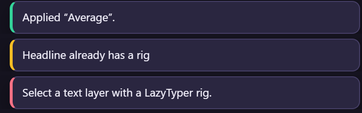

# 29. When something goes wrong

## Messages

Every message the panel can show, what it means and what to do. Red toasts are errors (nothing was
changed), amber ones are warnings (the rest was done).

| Message | Why | What to do |
|---|---|---|
| *Open a composition first.* | no composition is active | open the comp in the Timeline or the Comp panel |
| *Select a text layer first.* | Create was clicked without a text layer selected | select one or more text layers |
| *Select a text layer with a LazyTyper rig.* | the action needs a rig and none of the selected layers has one | select a rigged text layer (or its cursor or guide) |
| *Select a text layer whose rig has a cursor.* | applying or saving a cursor preset on a rig without a cursor | Add cursor first (chapter 12) |
| *Select a text layer with a LazyTyper rig and no cursor.* | Add cursor on a rig that already has one | nothing to do; or delete its cursor layer first |
| *‹layer› already has a rig* | Create on a rigged layer (skipped) | Remove it first, or change it with the other cards |
| *‹layer› has its own Source Text expression* | a Dynamic rig needs Source Text for itself (skipped) | make a Stable rig, or take your expression off |
| *‹layer› is already baked* | Bake on a baked rig among others (skipped) | nothing to do; Shift+click to unbake |
| *After Effects could not outline "‹layer›".* | a Stable rig measures the text with Create Shapes from Text, and it failed | check that the layer has visible text at the time indicator, then try again; or use Dynamic |
| *‹layer›: ‹an expression error›* | an expression reported an error right after it was written | Refresh; if it stays, see "Expressions" below |
| *Give the preset a name.* | Save with an empty name | type a name |
| *Could not save presets.json: …* | the presets file could not be written | check that `%APPDATA%\LazyTyper` (macOS: `~/Library/Application Support/LazyTyper`) is writable |
| *After Effects did not answer. Close and reopen the panel.* | the panel's link to After Effects was lost | close the panel and open it again from Window › Extensions; restart After Effects if it stays |
| *Nothing to rig.* | Create found nothing to do | select text layers |

## Problems

### The text does not type at all

- **Typing** is off at the start (a Typing keyframe, chapter 13), or the layer starts later than you
  think: typing never runs before the layer's in point.
- **Start at Character** is as long as the text: everything shows from the first frame.
- The rig is **baked** (the status line says *baked*): the controls no longer change anything.
  Shift+click Bake to unbake (chapter 10).
- A **Pause** marker covers the time (chapter 7).

### The cursor is in the wrong place

- The font, size, tracking, alignment or box changed after the rig was made: click **Refresh**
  (chapter 9). For a Stable rig, also after changing the text.
- An offset is set on the cursor layer (chapter 27).

### The status line looks old

The panel only asks After Effects about the selection while the pointer is over the panel, when the
panel gets focus, and after its own actions. Move the pointer over the panel.

### It plays slowly

Long texts are heavier in the Legacy ExtendScript engine: switch the project to JavaScript (File ›
Project Settings › Expressions), or **Bake** the rig, which makes it instant in either engine.

### Erase or Start typing does nothing

The rig is baked: unbake, change, bake again (chapter 10).

### Expressions

Every expression the rig writes starts with `// LazyTyper` and its version. If one shows an error
after you changed something by hand (renamed a control, deleted the guide), select the rig and click
**Refresh**: it writes them all again and adds any missing control. Renaming the rig's controls breaks
the expressions, which find them by name.

### The panel opens blank, or is missing

See [chapter 1](01-install.md#if-something-is-wrong): *Fix a blank panel.bat*, and restart After
Effects after installing.

## Still stuck?

Write to lettertosohan@gmail.com with your After Effects version, the message, and what you clicked.

## Related

- [1. Installing](01-install.md)
- [2. The panel at a glance](02-panel-at-a-glance.md)
- [9. Refresh](09-refresh.md)
